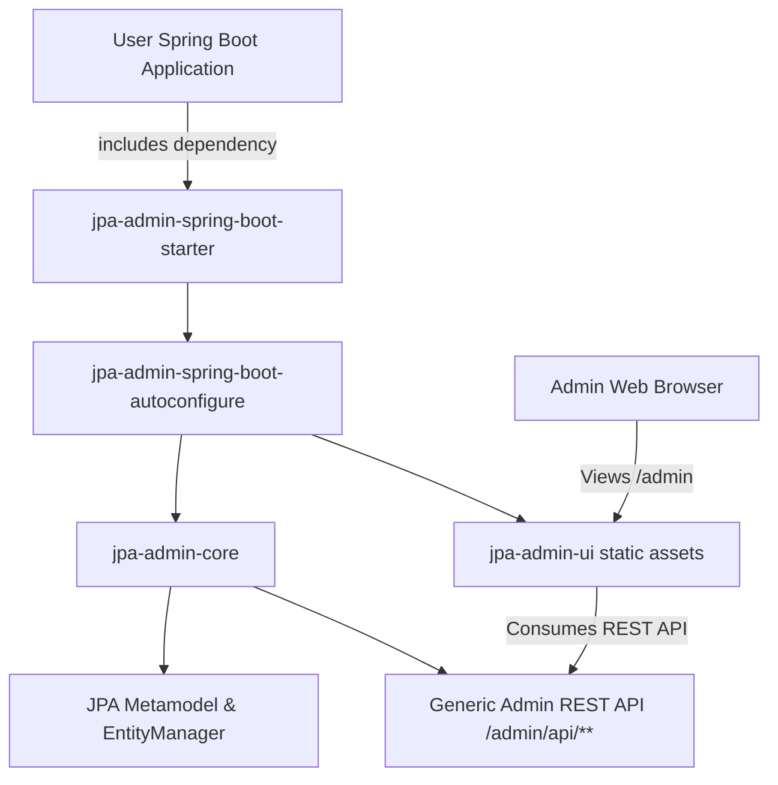
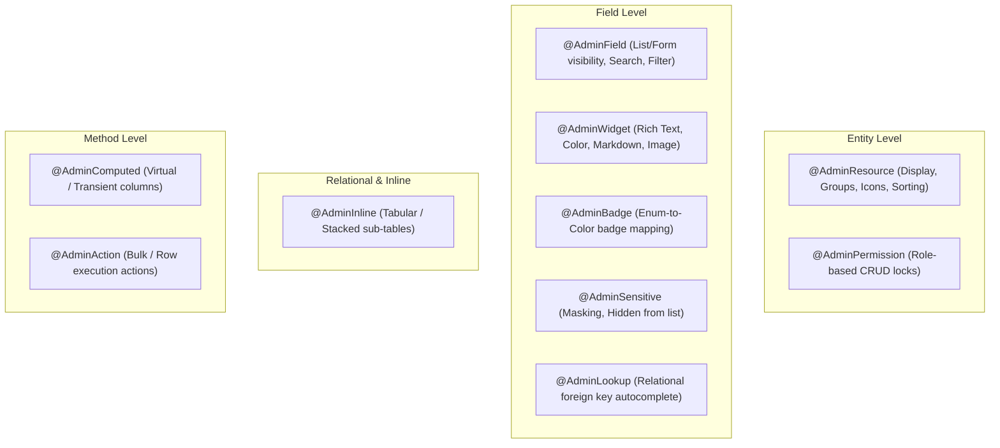
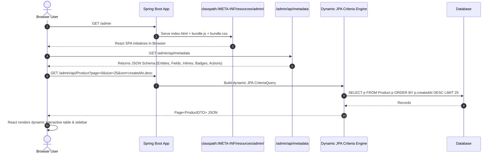

# Project Requirements Document (PRD)
# Spring Boot JPA Admin Starter ("Django Admin for Spring Boot")

---

## 1. Executive Summary & Vision

### 1.1 Objective
The goal is to develop a lightweight, plug-and-play **Spring Boot Starter** that automatically inspects an application's JPA metamodel and provides an out-of-the-box, modern, and customizable **Admin Dashboard & CRUD UI** with zero manual frontend coding—bringing the beloved productivity of **Django Admin** / **Laravel Nova** to the Spring Boot ecosystem.

### 1.2 Core Value Proposition
- **Zero Configuration to Start**: Add a single dependency (`spring-boot-starter-jpa-admin`), run the app, and navigate to `/admin` to see all entities automatically discovered with full CRUD capabilities.
- **Deep JPA & Validation Awareness**: Automatically respects JPA annotations (`@Id`, `@GeneratedValue`, `@Column(nullable = false)`, `@OneToMany`, `@ManyToOne`, `@ManyToMany`, `@Embedded`, Enums) and Bean Validation (`@NotNull`, `@Size`, `@Email`, `@Min`, `@Max`).
- **Production-Grade Extensibility**: Allows developers to override permissions, hide sensitive fields, register custom actions (e.g. "Export", "Approve", "Refund"), and define custom filter fields via Java configuration or annotations.
- **Modern, Polished UI**: Ships with a fast, responsive, and aesthetic interface (Dark/Light mode, searchable tables, dynamic relational selectors, instant search) bundled as static resources inside the JAR.

---

## 2. System Architecture & Modular Design

The project is structured as a Maven/Gradle multi-module project to separate core business logic, auto-configuration, and UI bundle.

```
spring-boot-jpa-admin/
├── jpa-admin-core/                  # Metamodel introspection, generic CRUD engine, event system
├── jpa-admin-ui/                    # Modern Single Page App (bundled static assets: HTML/JS/CSS)
├── jpa-admin-spring-boot-autoconfigure/ # Spring Boot auto-configuration & property binding
├── jpa-admin-spring-boot-starter/   # Aggregator starter dependency
└── jpa-admin-sample-app/            # Showcase/demo project with sample entities & relations
```



---

## 3. Functional Requirements

### 3.1 Entity Discovery & Metamodel Introspection (FR-1)
- **Automatic Detection**: On application startup, inspect `EntityManagerFactory` and JPA `Metamodel` to register all classes marked with `@Entity`.
- **Property Introspection**:
  - Primary Key detection (single PK, composite PK, UUID, numeric IDs).
  - Field types (`String`, `Integer`, `Long`, `BigDecimal`, `Boolean`, `LocalDate`, `LocalDateTime`, `Enum`, etc.).
  - Read-only fields (`insertable=false`, `updatable=false`, `@CreatedDate`, `@LastModifiedDate`).
  - Sensitive field protection (automatically mask/omit fields like `password`, `secret`, `token`, `hash` unless explicitly configured).
- **Relationship Resolution**:
  - `@ManyToOne` / `@OneToOne`: Rendered as searchable select/autocomplete lookup dropdowns.
  - `@OneToMany` / `@ManyToMany`: Rendered as inline relation tables or multi-select tag inputs.
  - `@Embedded`: Automatically expanded into nested form fieldsets.

---

### 3.2 Dynamic Generic CRUD Engine (FR-2)
The starter provides a generic controller `/admin/api/{entityName}` backed by dynamic JPA Criteria queries:

| HTTP Method | Endpoint | Description |
|---|---|---|
| `GET` | `/admin/api/metadata` | Returns all discovered entities, schema, fields, and permissions |
| `GET` | `/admin/api/{entity}` | Paginated listing with sorting, dynamic filtering, and global search |
| `GET` | `/admin/api/{entity}/{id}` | Detailed record view with resolved relational references |
| `POST` | `/admin/api/{entity}` | Create record with Bean Validation and relation linking |
| `PUT` / `PATCH` | `/admin/api/{entity}/{id}` | Update existing record with partial update support |
| `DELETE` | `/admin/api/{entity}/{id}` | Delete record (supports soft-delete hooks if configured) |
| `POST` | `/admin/api/{entity}/batch-delete` | Bulk delete multiple records by ID list |
| `POST` | `/admin/api/{entity}/actions/{actionName}` | Execute custom user-defined action (bulk or single) |
| `GET` | `/admin/api/{entity}/export` | Export filtered results to CSV / Excel (XLSX) |

---

### 3.3 Search, Filtering & Pagination (FR-3)
- **Pagination**: Server-side pagination using Spring Data `Pageable` (customizable default page sizes: 10, 25, 50, 100).
- **Global Search**: Substring/Like search across designated text fields (`name`, `email`, `title`, `description`).
- **Column-Specific Filters**:
  - **Date ranges**: For `LocalDate` and `LocalDateTime` (from date / to date).
  - **Boolean filters**: All / True / False (pill/toggle UI).
  - **Enum / Dropdown filters**: Multi-select pills or dropdown options.
  - **Numeric ranges**: Min / Max thresholds.
  - **Foreign key filters**: Filter records by related entity (e.g., Filter Products by Category).
- **Sorting**: Dynamic column clicking for ASC/DESC order.

---

### 3.4 Form Generation & Validation (FR-4)
- **Automatic Form Elements**:
  - `String` / `@Size` $\rightarrow$ Text input with character counter.
  - `@Lob` / Large text $\rightarrow$ Multi-line Textarea / Rich Markdown editor.
  - `Boolean` $\rightarrow$ Toggle switch or checkbox.
  - `Enum` $\rightarrow$ Dropdown select with humanized labels.
  - `LocalDate` / `LocalDateTime` $\rightarrow$ Native Date/Time picker.
  - `Number` / `BigDecimal` $\rightarrow$ Number input with precision and currency formatting support.
  - Associations $\rightarrow$ Async typeahead search select with pagination for large foreign tables.
- **Client & Server Validation**:
  - UI checks Bean Validation rules before submission.
  - Server catches `ConstraintViolationException` and formats field-level validation errors into standard JSON responses shown under each input field.

---

### 3.5 Custom Actions & Extensibility (FR-5)
Just like Django Admin's `@admin.action`, developers can register bulk or individual actions:
- **Example Actions**: "Send Verification Email", "Export Selected as PDF", "Mark Orders as Shipped", "Activate / Deactivate Users".
- **Confirmation Prompts**: Optional dialog asking for confirmation before executing destructive custom actions.
- **Custom Views/Pages**: Capability to add custom navigation items and custom iframe/React pages to the admin menu.

---

### 3.6 Security & Access Control (FR-6)
- **Spring Security Integration**:
  - Seamlessly plugs into existing `SecurityFilterChain`.
  - Configurable required roles (e.g. `ROLE_ADMIN`, `ROLE_SUPERUSER`).
  - Standalone simple Basic Auth mode if Spring Security is not present or when standalone protection is preferred.
- **Granular Permissions**:
  - Per-entity permissions: `canView`, `canCreate`, `canEdit`, `canDelete`.
  - Read-only entities (e.g. audit log tables or read-only views).

---

## 4. UI / UX Design Specifications

### 4.1 Aesthetic & Visual Standards
- **Design Philosophy**: Clean, high-density, modern SaaS look (similar to Tailwind UI, Linear, or Stripe Dashboard).
- **Color Themes**: Built-in Dark Mode and Light Mode with system auto-detection and toggle switch.
- **Typography**: Inter / System UI font stack for crisp data readability.
- **Micro-interactions**: Toast notifications for operations, loading skeletons, smooth sidebar transitions, modal dialogs for quick previews.

### 4.2 Dashboard & Layout
- **Sidebar Navigation**:
  - Collapsible sidebar categorized by entity groups/packages (e.g., "User Management", "E-Commerce", "System Settings").
  - Badge counts showing total records per entity.
- **Home / Dashboard Overview**:
  - Summary metrics cards (Total Users, Total Orders, etc.).
  - Recent activity feed (recent creations/updates).
  - Quick action links.
- **Entity Table View**:
  - Sticky table headers, column visibility selector, dense vs. comfortable row spacing toggle.
  - Checkbox selection for bulk operations.
  - Quick inline preview drawer for viewing record details without leaving the table.

---

## 5. Developer Configuration & Customization API

### 5.1 `application.yml` Configuration Schema

```yaml
spring:
  jpa:
    admin:
      enabled: true
      path: /admin
      title: "My Company Admin"
      logo-url: "/images/logo.svg"
      default-page-size: 25
      export-enabled: true
      security:
        enabled: true
        roles:
          - "ADMIN"
          - "SUPER_ADMIN"
      entities:
        include:
          - "com.example.domain.*"
        exclude:
          - "com.example.domain.InternalFlywayHistory"
```

### 5.2 Comprehensive Annotation-Driven UI Customization

The starter provides a rich suite of intuitive, declarative annotations allowing developers to completely customize how entities, fields, relationships, forms, and custom actions look and behave without touching any frontend code.



---

#### 5.2.1 Class-Level Annotations

##### `@AdminResource`
Defines top-level presentation and behavior for an `@Entity`:

| Attribute | Type | Default | Description |
|---|---|---|---|
| `displayName` | `String` | Entity Class Name | Human-friendly name displayed on headings and tables |
| `pluralName` | `String` | `<displayName>s` | Pluralized name (e.g. "Categories", "People") |
| `group` | `String` | `"General"` | Sidebar menu section/category |
| `icon` | `String` | `"database"` | Lucide icon identifier (e.g. `"users"`, `"shopping-cart"`, `"shield"`, `"box"`) |
| `order` | `int` | `100` | Sorting position in the sidebar menu |
| `readOnly` | `boolean` | `false` | When `true`, disables Create, Edit, and Delete globally |
| `creatable` | `boolean` | `true` | Enables or disables the "New Record" button |
| `updatable` | `boolean` | `true` | Enables or disables the "Edit" action |
| `deletable` | `boolean` | `true` | Enables or disables record deletion (both single and bulk) |
| `exportable` | `boolean` | `true` | Enables CSV / Excel export for this entity |
| `defaultSortBy` | `String` | `"id"` | Default property name to sort by upon loading table |
| `defaultSortDir`| `SortDir`| `DESC` | `ASC` or `DESC` default sort direction |
| `pageSize` | `int` | `25` | Default number of records per page |
| `hidden` | `boolean` | `false` | Completely hides the entity from the Admin sidebar and UI |

##### `@AdminPermission`
Enforces role-based access rules directly on the entity:

```java
@AdminPermission(
    roles = {"ROLE_ADMIN", "ROLE_MANAGER"},
    deleteRoles = {"ROLE_SUPER_ADMIN"} // Restrict delete to superadmins only
)
```

---

#### 5.2.2 Field-Level Annotations

##### `@AdminField`
Controls how individual attributes are rendered in tables, detail views, and forms:

| Attribute | Type | Default | Description |
|---|---|---|---|
| `label` | `String` | Auto-spaced field name | Custom column header and form field label |
| `description` | `String` | `""` | Subtitle / helper tooltip displayed under the form input |
| `order` | `int` | `100` | Field display order in tables and forms |
| `inList` | `boolean` | `true` | Whether the field appears in the data table list |
| `inForm` | `boolean` | `true` | Whether the field appears in Create/Edit forms |
| `inDetail` | `boolean` | `true` | Whether the field appears in the read-only Detail view |
| `readOnly` | `boolean` | `false` | Field cannot be edited in form (rendered as read-only badge/text) |
| `searchable` | `boolean` | `false` | Included in top global search query (backed by `LIKE %query%`) |
| `sortable` | `boolean` | `true` | Allows user to click table header to sort by this column |
| `filterable` | `boolean` | `false` | Generates a dynamic filter widget in the table filter bar |
| `placeholder` | `String` | `""` | HTML input placeholder text |

##### `@AdminWidget`
Overrides the default input control with specialized rich UI widgets:

```java
@AdminWidget(type = WidgetType.RICH_TEXT) // WYSIWYG / Markdown editor
@AdminWidget(type = WidgetType.COLOR_PICKER) // Hex color picker with preview
@AdminWidget(type = WidgetType.IMAGE_URL, previewSize = "64px") // Shows image thumbnail
@AdminWidget(type = WidgetType.SLIDER, min = 0, max = 100, step = 5) // Range slider
@AdminWidget(type = WidgetType.CODE_EDITOR, language = "json") // Code editor with syntax highlighting
@AdminWidget(type = WidgetType.BOOLEAN_SWITCH) // Toggle switch instead of standard checkbox
```

##### `@AdminBadge`
Maps enum constants or string values to color-coded status badges in table views:

```java
@Enumerated(EnumType.STRING)
@AdminBadge(mapping = {
    @BadgeMap(value = "PENDING", color = BadgeColor.YELLOW, label = "Pending Review"),
    @BadgeMap(value = "ACTIVE", color = BadgeColor.GREEN, label = "Active"),
    @BadgeMap(value = "SUSPENDED", color = BadgeColor.RED, label = "Suspended"),
    @BadgeMap(value = "ARCHIVED", color = BadgeColor.GRAY, label = "Archived")
})
private AccountStatus status;
```

##### `@AdminSensitive`
Protects sensitive data (e.g. passwords, SSNs, API keys):
- Automatically hides field value from API responses and data tables.
- Renders as a masked password field in edit forms (`••••••••`).
- Omits from audit logs and exports.

##### `@AdminLookup`
Configures relational foreign keys (`@ManyToOne`, `@OneToOne`):
- `lookupProperty`: Property of target entity to display in dropdown (e.g. `"fullName"` or `"name"`).
- `searchProperty`: Property used when user types into the async autocomplete search.
- `quickCreate`: Enables a "+" button inside the dropdown to create the foreign entity in a modal popup without navigating away.

---

#### 5.2.3 Inline Relationship Annotations (`@AdminInline`)
Mimicking Django's powerful `TabularInline` and `StackedInline`, developers can manage child entities directly within the parent's form:

```java
@Entity
public class Order {

    @Id
    @GeneratedValue
    private Long id;

    // Renders an editable sub-table of order items directly inside the Order edit view
    @OneToMany(mappedBy = "order", cascade = CascadeType.ALL, orphanRemoval = true)
    @AdminInline(
        type = InlineType.TABULAR, // TABULAR (grid table) or STACKED (card panels)
        title = "Order Items",
        canAdd = true,
        canDelete = true,
        limit = 50
    )
    private List<OrderItem> items = new ArrayList<>();
}
```

---

#### 5.2.4 Virtual / Computed Columns (`@AdminComputed`)
Annotates getter methods for transient or calculated values that do not exist as database columns:

```java
@Transient
@AdminComputed(
    label = "Full Name",
    order = 2,
    inList = true,
    inDetail = true
)
public String getFullName() {
    return this.firstName + " " + this.lastName;
}

@Transient
@AdminComputed(
    label = "Total Value",
    order = 5,
    format = "currency:$"
)
public BigDecimal calculateTotalValue() {
    return items.stream()
        .map(OrderItem::getSubtotal)
        .reduce(BigDecimal.ZERO, BigDecimal::add);
}
```

---

#### 5.2.5 Custom Method Actions (`@AdminAction`)
Defines business actions that can be triggered directly from the UI:

```java
@Entity
public class Customer {

    // Row-level or Bulk Action accessible from the table action dropdown or bulk bar
    @AdminAction(
        name = "Send Welcome Email",
        icon = "mail",
        confirmation = "Are you sure you want to send welcome emails to selected customer(s)?",
        scope = ActionScope.BOTH // SINGLE_ROW, BULK_SELECTION, or BOTH
    )
    public static void sendWelcomeEmail(List<Customer> selectedCustomers, EmailService emailService) {
        // Business logic executed on the server
    }

    @AdminAction(
        name = "Approve Account",
        icon = "check-circle",
        scope = ActionScope.SINGLE_ROW
    )
    public void approveAccount() {
        this.status = AccountStatus.ACTIVE;
    }
}
```

---

#### 5.2.6 Full Annotated Entity Example

```java
package com.example.domain;

import jakarta.persistence.*;
import jakarta.validation.constraints.*;
import io.github.jpaadmin.annotations.*;
import java.math.BigDecimal;
import java.time.LocalDateTime;

@Entity
@Table(name = "products")
@AdminResource(
    displayName = "Store Product",
    pluralName = "Products",
    group = "Catalog",
    icon = "package",
    defaultSortBy = "createdAt",
    defaultSortDir = SortDir.DESC
)
@AdminPermission(roles = {"ROLE_ADMIN", "ROLE_INVENTORY_MANAGER"})
public class Product {

    @Id
    @GeneratedValue(strategy = GenerationType.IDENTITY)
    @AdminField(label = "SKU ID", order = 1, sortable = true)
    private Long id;

    @Column(nullable = false)
    @NotBlank
    @AdminField(label = "Product Title", order = 2, searchable = true, sortable = true)
    private String name;

    @Lob
    @AdminField(label = "Description", inList = false)
    @AdminWidget(type = WidgetType.RICH_TEXT)
    private String description;

    @NotNull
    @Positive
    @AdminField(label = "Unit Price", order = 3, sortable = true, filterable = true)
    private BigDecimal price;

    @NotNull
    @Min(0)
    @AdminField(label = "Stock Qty", order = 4, sortable = true)
    private Integer stockQuantity;

    @Enumerated(EnumType.STRING)
    @AdminField(label = "Publish Status", order = 5, filterable = true)
    @AdminBadge(mapping = {
        @BadgeMap(value = "DRAFT", color = BadgeColor.GRAY),
        @BadgeMap(value = "PUBLISHED", color = BadgeColor.GREEN),
        @BadgeMap(value = "OUT_OF_STOCK", color = BadgeColor.RED)
    })
    private ProductStatus status;

    @ManyToOne(fetch = FetchType.LAZY)
    @JoinColumn(name = "category_id")
    @AdminField(label = "Category", order = 6, filterable = true)
    @AdminLookup(lookupProperty = "title", searchProperty = "title", quickCreate = true)
    private Category category;

    @Column(updatable = false)
    @AdminField(label = "Created Date", order = 7, readOnly = true, inForm = false)
    private LocalDateTime createdAt = LocalDateTime.now();

    @Transient
    @AdminComputed(label = "In Stock?", order = 8)
    public boolean isInStock() {
        return stockQuantity != null && stockQuantity > 0;
    }
}
```

---

### 5.3 Programmatic Java Configuration (Fluent API)

For existing domain models where adding annotations is undesirable:

```java
@Configuration
public class AdminConfig implements JpaAdminConfigurer {

    @Override
    public void configure(AdminRegistry registry) {
        registry.forEntity(Product.class)
            .displayName("Catalog Item")
            .icon("package")
            .group("Catalog")
            .listColumns("id", "name", "price", "stockQuantity", "status", "category")
            .searchableColumns("name", "category.title")
            .filterableColumns("status", "price", "category")
            .badgeMapping("status", Map.of(
                "DRAFT", BadgeColor.GRAY,
                "PUBLISHED", BadgeColor.GREEN,
                "OUT_OF_STOCK", BadgeColor.RED
            ))
            .registerAction("Mark as Published", (selectedIds, entityManager) -> {
                // Custom execution logic
            });
    }
}
```

---

## 6. Detailed Technical Implementation Guide & Blueprint

This section provides the exact technical implementation blueprint for building the starter, including how the React frontend is developed, built, bundled, and served by Spring Boot, and how the dynamic JPA backend operates.



---

### 6.1 Multi-Module Project Structure

The project is structured into 4 core modules:

```
admin-for-springboot/
├── pom.xml                                  # Root aggregator & dependency management
├── jpa-admin-core/                          # Java: Metamodel scanner, annotations, generic CRUD
│   ├── pom.xml
│   └── src/main/java/io/github/jpaadmin/
│       ├── annotations/                     # @AdminResource, @AdminField, @AdminInline...
│       ├── metadata/                        # JpaMetamodelScanner & DTO models
│       ├── service/                         # DynamicCrudService (CriteriaBuilder queries)
│       └── web/                             # AdminApiController & export endpoints
├── jpa-admin-ui/                            # React + Vite: Frontend SPA source & build
│   ├── pom.xml                              # Uses frontend-maven-plugin to run Vite build
│   ├── package.json                         # React 18/19, Tailwind, Lucide, TanStack
│   ├── vite.config.ts
│   └── src/
│       ├── components/                      # Table, Form, Inline, Badge, Modal components
│       ├── context/                         # MetadataContext, ThemeContext
│       └── views/                           # ListView, FormView, DetailView, DashboardView
├── jpa-admin-spring-boot-autoconfigure/     # Auto-configuration & WebMvc resource mapping
│   ├── pom.xml
│   └── src/main/java/io/github/jpaadmin/boot/
│       ├── config/                          # JpaAdminProperties & JpaAdminWebMvcConfigurer
│       └── JpaAdminAutoConfiguration.java
├── jpa-admin-spring-boot-starter/           # Starter POM aggregating core + autoconfigure + ui
│   └── pom.xml
└── jpa-admin-sample-app/                    # Runnable Spring Boot demo with sample entities
    ├── pom.xml
    └── src/main/java/com/example/demo/
```

---

### 6.2 Frontend Implementation (`jpa-admin-ui`)

#### 6.2.1 Technology & Tooling
- **Framework**: React 18/19 with TypeScript.
- **Build Tool**: Vite (blazing fast bundling and HMR during development).
- **Styling**: TailwindCSS with CSS custom properties for sleek Dark/Light themes.
- **Icons**: `lucide-react` (mapped dynamically to strings from `@AdminResource(icon = "...")`).
- **Data Table**: `@tanstack/react-table` (virtualized, sortable, customizable columns).
- **HTTP Client**: Native browser `fetch()` or lightweight Axios.

#### 6.2.2 Core React Architecture & Dynamic Components
1. **`MetadataContext`**:
   - On app startup, fetches `/admin/api/metadata`.
   - Stores the list of discovered entities, their field definitions, relationships, badges, and permissions in React state.
   - Automatically populates the sidebar grouped by `@AdminResource(group = "...")`.
2. **`DynamicListView`**:
   - Reads field metadata to render columns (`inList = true`).
   - Supports search input (debounced `300ms`), filter popovers (date range, enum checkboxes, boolean pills), and column header click-to-sort.
   - Bulk action bar that appears when rows are selected via checkboxes.
3. **`DynamicFormView`**:
   - Recursively generates form inputs based on field data type and `@AdminWidget`.
   - Enforces client-side validation using the Bean Validation constraints sent in the metadata.
   - Handles relationships:
     - `@ManyToOne`: Async typeahead dropdown that searches `/admin/api/{relatedEntity}/lookup?q=...`.
     - Includes a quick `+` button opening a modal to create the related entity on the fly.
4. **`InlineTableEditor`** (`@AdminInline`):
   - Renders child entities directly inside the parent form.
   - Supports adding new child rows, updating existing rows, and marking rows for deletion before saving the parent entity.

#### 6.2.3 Build & Automated Packaging via Maven
The `jpa-admin-ui/pom.xml` uses the **`frontend-maven-plugin`** so developers building the Java project don't even need Node.js globally installed:

```xml
<!-- jpa-admin-ui/pom.xml -->
<plugin>
    <groupId>com.github.eirslett</groupId>
    <artifactId>frontend-maven-plugin</artifactId>
    <version>1.15.0</version>
    <executions>
        <!-- 1. Download isolated Node & npm into target directory -->
        <execution>
            <id>install node and npm</id>
            <goals><goal>install-node-and-npm</goal></goals>
            <configuration>
                <nodeVersion>v20.11.1</nodeVersion>
                <npmVersion>10.2.4</npmVersion>
            </configuration>
        </execution>
        <!-- 2. Run npm install -->
        <execution>
            <id>npm install</id>
            <goals><goal>npm</goal></goals>
            <configuration><arguments>install</arguments></configuration>
        </execution>
        <!-- 3. Run npm run build (Vite outputs to dist/) -->
        <execution>
            <id>npm run build</id>
            <goals><goal>npm</goal></goals>
            <configuration><arguments>run build</arguments></configuration>
        </execution>
    </executions>
</plugin>

<!-- 4. Copy dist/ output into JAR classpath under META-INF/resources/admin/ -->
<plugin>
    <artifactId>maven-resources-plugin</artifactId>
    <executions>
        <execution>
            <id>copy-ui-to-resources</id>
            <phase>process-resources</phase>
            <goals><goal>copy-resources</goal></goals>
            <configuration>
                <outputDirectory>${project.build.outputDirectory}/META-INF/resources/admin</outputDirectory>
                <resources>
                    <resource><directory>dist</directory></resource>
                </resources>
            </configuration>
        </execution>
    </executions>
</plugin>
```

---

### 6.3 Spring Boot Static Resource Serving & SPA Routing

When a single-page application (SPA) with client-side routing (e.g. `/admin/entities/Product/new`) is served by Spring Boot, any direct URL visit or page refresh must return `index.html` instead of a 404.

#### 6.3.1 Resource Handler Registration
```java
@Configuration
public class JpaAdminWebMvcConfigurer implements WebMvcConfigurer {

    private final JpaAdminProperties properties;

    public JpaAdminWebMvcConfigurer(JpaAdminProperties properties) {
        this.properties = properties;
    }

    @Override
    public void addResourceHandlers(ResourceHandlerRegistry registry) {
        String adminPath = properties.getPath(); // e.g. "/admin"
        
        // Serve static assets (JS, CSS, images, icons)
        registry.addResourceHandler(adminPath + "/**")
                .addResourceLocations("classpath:/META-INF/resources/admin/")
                .resourceChain(true)
                .addResolver(new PathResourceResolver() {
                    @Override
                    protected Resource getResource(String resourcePath, Resource location) throws IOException {
                        Resource requested = location.createRelative(resourcePath);
                        // If file exists (e.g. admin.js, style.css), return it; otherwise forward to index.html for SPA routing
                        return (requested.exists() && requested.isReadable()) ? requested : location.createRelative("index.html");
                    }
                });
    }
}
```

---

### 6.4 JPA Metamodel Scanner (`jpa-admin-core`)

On application startup, `JpaMetamodelScanner` inspects the active `EntityManagerFactory`:

```java
@Service
public class JpaMetamodelScanner {

    private final EntityManager entityManager;
    private final Map<String, EntityMetadata> entityRegistry = new ConcurrentHashMap<>();

    public JpaMetamodelScanner(EntityManager entityManager) {
        this.entityManager = entityManager;
    }

    @PostConstruct
    public void scan() {
        Metamodel metamodel = entityManager.getMetamodel();
        for (EntityType<?> entityType : metamodel.getEntities()) {
            Class<?> javaType = entityType.getJavaType();
            
            // Check @AdminResource and defaults
            AdminResource resourceAnn = javaType.getAnnotation(AdminResource.class);
            if (resourceAnn != null && resourceAnn.hidden()) continue;

            EntityMetadata metadata = new EntityMetadata();
            metadata.setEntityName(entityType.getName());
            metadata.setJavaClassName(javaType.getName());
            metadata.setDisplayName(resourceAnn != null ? resourceAnn.displayName() : splitCamelCase(entityType.getName()));
            metadata.setPluralName(resourceAnn != null ? resourceAnn.pluralName() : metadata.getDisplayName() + "s");
            metadata.setGroup(resourceAnn != null ? resourceAnn.group() : "General");
            metadata.setIcon(resourceAnn != null ? resourceAnn.icon() : "database");
            metadata.setDefaultSortBy(resourceAnn != null ? resourceAnn.defaultSortBy() : "id");

            // Introspect attributes & relationships
            for (Attribute<?, ?> attr : entityType.getAttributes()) {
                FieldMetadata fieldMeta = inspectField(attr, javaType);
                metadata.addField(fieldMeta);
            }

            // Introspect inline relationships (@AdminInline)
            inspectInlines(metadata, javaType);

            // Introspect virtual computed fields (@AdminComputed)
            inspectComputedMethods(metadata, javaType);

            // Introspect custom actions (@AdminAction)
            inspectActions(metadata, javaType);

            entityRegistry.put(entityType.getName().toLowerCase(), metadata);
        }
    }

    public EntityMetadata getMetadata(String entityName) {
        return entityRegistry.get(entityName.toLowerCase());
    }

    public Collection<EntityMetadata> getAllMetadata() {
        return entityRegistry.values();
    }
}
```

---

### 6.5 Dynamic Generic Criteria CRUD Engine

The `DynamicCrudService` performs type-safe database queries without requiring pre-written repositories for each entity:

```java
@Service
@Transactional
public class DynamicCrudService {

    private final EntityManager entityManager;
    private final JpaMetamodelScanner scanner;
    private final ObjectMapper objectMapper;

    public PageResult<Map<String, Object>> listRecords(
            String entityName,
            Pageable pageable,
            String searchQuery,
            Map<String, String> filters) {

        EntityMetadata metadata = scanner.getMetadata(entityName);
        Class<?> entityClass = Class.forName(metadata.getJavaClassName());

        CriteriaBuilder cb = entityManager.getCriteriaBuilder();
        CriteriaQuery<Object> cq = cb.createQuery();
        Root<?> root = cq.from(entityClass);

        List<Predicate> predicates = new ArrayList<>();

        // 1. Build Global Search Predicates across all @AdminField(searchable=true)
        if (StringUtils.hasText(searchQuery)) {
            List<Predicate> searchPredicates = new ArrayList<>();
            for (FieldMetadata field : metadata.getSearchableFields()) {
                searchPredicates.add(cb.like(
                    cb.lower(root.get(field.getName()).as(String.class)),
                    "%" + searchQuery.toLowerCase() + "%"
                ));
            }
            if (!searchPredicates.isEmpty()) {
                predicates.add(cb.or(searchPredicates.toArray(new Predicate[0])));
            }
        }

        // 2. Build Column Filter Predicates (dates, enums, numbers, booleans)
        filters.forEach((field, val) -> {
            if (metadata.hasField(field) && StringUtils.hasText(val)) {
                predicates.add(cb.equal(root.get(field), parseValue(val, metadata.getField(field))));
            }
        });

        cq.where(predicates.toArray(new Predicate[0]));

        // 3. Dynamic Sorting
        if (pageable.getSort().isSorted()) {
            List<Order> orders = pageable.getSort().stream()
                .map(s -> s.isAscending() ? cb.asc(root.get(s.getProperty())) : cb.desc(root.get(s.getProperty())))
                .toList();
            cq.orderBy(orders);
        }

        // 4. Execute Paginated Query
        TypedQuery<Object> query = entityManager.createQuery(cq);
        query.setFirstResult((int) pageable.getOffset());
        query.setMaxResults(pageable.getPageSize());

        List<Object> rawResults = query.getResultList();
        long totalCount = executeCountQuery(entityClass, predicates);

        // 5. Serialize safely to Map DTOs to avoid lazy loading circular loops
        List<Map<String, Object>> dtos = rawResults.stream()
            .map(item -> serializeEntity(item, metadata))
            .toList();

        return new PageResult<>(dtos, totalCount, pageable.getPageNumber(), pageable.getPageSize());
    }

    public Object createOrUpdate(String entityName, Map<String, Object> payload, Long id) {
        EntityMetadata metadata = scanner.getMetadata(entityName);
        Class<?> entityClass = Class.forName(metadata.getJavaClassName());

        Object entity = (id != null) ? entityManager.find(entityClass, id) : entityClass.getDeclaredConstructor().newInstance();

        // Bind scalar properties and resolve foreign key associations via entityManager.getReference()
        bindPayloadToEntity(entity, payload, metadata);

        // Trigger Bean Validation manually or catch JPA validation exceptions
        entityManager.persist(entity);
        return serializeEntity(entity, metadata);
    }
}
```

---

### 6.6 Spring Boot Auto-Configuration Mechanism

The starter connects to Spring Boot 3 using the modern `AutoConfiguration` import mechanism:

```
jpa-admin-spring-boot-autoconfigure/
└── src/main/resources/
    └── META-INF/
        └── spring/
            └── org.springframework.boot.autoconfigure.AutoConfiguration.imports
```

Inside `AutoConfiguration.imports`:
```properties
io.github.jpaadmin.boot.JpaAdminAutoConfiguration
```

The auto-configuration class:
```java
@AutoConfiguration
@ConditionalOnWebApplication(type = ConditionalOnWebApplication.Type.SERVLET)
@ConditionalOnClass({EntityManagerFactory.class, WebMvcConfigurer.class})
@ConditionalOnProperty(prefix = "spring.jpa.admin", name = "enabled", havingValue = "true", matchIfMissing = true)
@EnableConfigurationProperties(JpaAdminProperties.class)
@ComponentScan(basePackages = "io.github.jpaadmin")
public class JpaAdminAutoConfiguration {

    @Bean
    @ConditionalOnMissingBean
    public JpaAdminWebMvcConfigurer jpaAdminWebMvcConfigurer(JpaAdminProperties properties) {
        return new JpaAdminWebMvcConfigurer(properties);
    }

    @Bean
    @ConditionalOnMissingBean
    public JpaMetamodelScanner jpaMetamodelScanner(EntityManager entityManager) {
        return new JpaMetamodelScanner(entityManager);
    }

    @Bean
    @ConditionalOnMissingBean
    public DynamicCrudService dynamicCrudService(EntityManager entityManager, JpaMetamodelScanner scanner, ObjectMapper mapper) {
        return new DynamicCrudService(entityManager, scanner, mapper);
    }
}
```

---

## 7. Technical Stack & Dependencies

| Component | Choice | Rationale |
|---|---|---|
| **Backend Framework** | Spring Boot 3.2+ (Java 17 / 21) | Current long-term standards, Spring 6 foundation |
| **ORM / Persistence** | Hibernate 6.x / JPA 3.1 | Core metamodel introspection and CriteriaBuilder queries |
| **UI Framework** | Vite + React + TailwindCSS (bundled) | High-speed, responsive, compiled down into static JAR resources |
| **Build Plugin** | `frontend-maven-plugin` (Node isolated) | End-user and CI builds require zero globally installed Node.js |
| **Asset Delivery** | Spring Boot ResourceHandler (`META-INF/resources/admin/**`) | Single JAR deployment; zero external runtime requirements |
| **Data Serialization** | Jackson (with custom DTO mapping) | Prevents `LazyInitializationException` & circular reference loops |
| **Security** | Spring Security 6 integration | Enterprise grade RBAC compatibility |

---

## 8. Non-Functional Requirements

1. **Zero Runtime Overhead on Main App**: Metamodel inspection occurs only at startup; dynamic queries are optimized with index hints and explicit pagination to avoid full-table scans.
2. **Lazy Loading Safety**: API endpoints must avoid `LazyInitializationException` and Jackson N+1 circular reference loops using DTO projection or selective `Hibernate.unproxy()` serialization.
3. **Packaging & Distribution**:
   - Single maven dependency: `com.github.yourusername:spring-boot-starter-jpa-admin:1.0.0`.
   - Packaged size of starter JAR should stay under 5MB (optimized web assets).
4. **Browser Compatibility**: Fully tested across Chrome, Firefox, Safari, and Edge.

---

## 9. Implementation Roadmap & Milestones

### Phase 1: Core Engine & Metadata Discovery (Weeks 1 - 2)
- [ ] Setup multi-module Maven/Gradle project.
- [ ] Implement JPA Metamodel Scanner service.
- [ ] Build metadata reflection DTO generator (`/admin/api/metadata`).
- [ ] Implement Dynamic JPA Criteria Specification engine for generic CRUD (`GET`, `POST`, `PUT`, `DELETE`).

### Phase 2: Frontend Dashboard & Entity Views (Weeks 3 - 4)
- [ ] Build Vite + React UI shell with responsive sidebar and Dark/Light mode.
- [ ] Implement dynamic data table with server-side pagination, sorting, and search.
- [ ] Implement dynamic form generator based on field types and Bean Validation rules.
- [ ] Bundle compiled frontend assets into `META-INF/resources/admin/`.

### Phase 3: Relationships, Filter Systems & Actions (Weeks 5 - 6)
- [ ] Relational autocomplete pickers (`@ManyToOne`, `@OneToMany`).
- [ ] Column-specific filters (Date range, Boolean pills, Enums).
- [ ] Batch selection and bulk delete.
- [ ] Custom action registry (Java fluent API and `@AdminAction`).

### Phase 4: Security, Export & Extensibility (Weeks 7 - 8)
- [ ] Spring Security auto-configuration filter.
- [ ] CSV / Excel data export endpoint.
- [ ] Sample showcase application with diverse JPA mappings (`@OneToMany`, `@ManyToMany`, `@Embedded`).
- [ ] Documentation, GitHub README, and Maven Central publishing pipeline.

---

## 10. Success Criteria
1. Adding the dependency to an existing multi-entity Spring Boot project launches a functioning, beautiful Admin UI on `/admin` without any extra configuration.
2. Form validation accurately mimics server-side constraints.
3. Zero `LazyInitializationException` occurrences when navigating bidirectional relationships.
4. Developers can customize layouts and actions using both annotations and fluent Java configuration.
