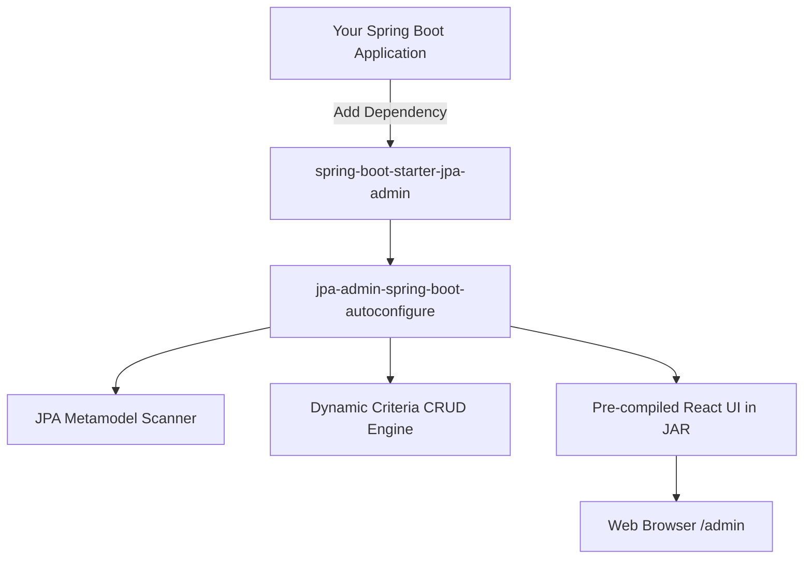

# Spring Boot JPA Admin Starter 🚀
### Dynamic, Annotation-Driven Admin Console for JPA Entities ("Django Admin for Spring Boot")

---

A plug-and-play Spring Boot Starter that automatically inspects your JPA metamodel and generates a modern, responsive, and customizable **Admin Dashboard & CRUD UI** at `/admin` with **zero configuration required**.



---

## ✨ Features

- ⚡️ **Zero Configuration to Start**: Add the starter dependency, start your Spring Boot app, and visit `http://localhost:8080/admin`.
- 🔍 **Automatic Entity & Attribute Discovery**: Automatically reflects all `@Entity` classes, primary keys, and field types.
- 🎨 **Modern SaaS UI**: Bundled React 18 + Vite + TailwindCSS Single Page App with Dark/Light mode and Lucide icons.
- 🏷 **Customization Annotations**:
  - `@AdminResource`: Display name, pluralization, grouping, Lucide icons, default sorting.
  - `@AdminField`: Visibility in lists/forms, custom labels, searchability, and filterability.
  - `@AdminBadge`: Map Enum values to status badge colors (`GREEN`, `YELLOW`, `RED`, `BLUE`, etc.).
  - `@AdminLookup`: Relational autocomplete dropdowns for foreign keys (`@ManyToOne`, `@OneToOne`).
  - `@AdminInline`: Tabular and stacked child tables directly inside parent edit forms (`@OneToMany`).
  - `@AdminComputed`: Expose virtual/calculated getter methods on tables.
  - `@AdminSensitive`: Mask sensitive fields (`••••••••`) like passwords and tokens.
  - `@AdminAction`: Custom row and bulk business actions.
- ⚡️ **Zero Node.js Runtime**: The frontend is pre-compiled into static resources inside the JAR. Users never need Node.js or npm.

---

## 📦 Getting Started

### 1. Add the Dependency

Add the starter to your Spring Boot 3 `pom.xml`:

```xml
<dependency>
    <groupId>io.github.jpaadmin</groupId>
    <artifactId>jpa-admin-spring-boot-starter</artifactId>
    <version>1.0.0-SNAPSHOT</version>
</dependency>
```

*(Or Gradle)*
```groovy
implementation 'io.github.jpaadmin:jpa-admin-spring-boot-starter:1.0.0-SNAPSHOT'
```

### 2. Configure `application.yml` (Optional)

```yaml
spring:
  jpa:
    admin:
      enabled: true
      path: /admin
      title: "Store Admin Console"
      pageSize: 25
      export-enabled: true
      security:
        username: ${ADMIN_USERNAME:admin}
        password: ${ADMIN_PASSWORD:admin}
```

### 3. Start your App

Navigate to:
```
http://localhost:8080/admin
```

---

## 🛠 Annotation Reference & Examples

### 1. Class-Level Annotations

```java
@Entity
@Table(name = "products")
@AdminResource(
    displayName = "Product",
    pluralName = "Products",
    group = "Catalog",
    icon = "package",
    defaultSortBy = "id",
    defaultSortDir = SortDir.DESC
)
public class Product { ... }
```

### 2. Field-Level Annotations & Badges

```java
@AdminField(label = "Unit Price ($)", sortable = true, filterable = true)
private BigDecimal price;

@Enumerated(EnumType.STRING)
@AdminField(label = "Publish Status", filterable = true)
@AdminBadge(mapping = {
    @BadgeMap(value = "DRAFT", color = BadgeColor.GRAY, label = "Draft"),
    @BadgeMap(value = "PUBLISHED", color = BadgeColor.GREEN, label = "Published"),
    @BadgeMap(value = "OUT_OF_STOCK", color = BadgeColor.RED, label = "Out of Stock")
})
private ProductStatus status;
```

### 3. Relational Lookups (`@ManyToOne`)

```java
@ManyToOne(fetch = FetchType.LAZY)
@AdminField(label = "Category", filterable = true)
@AdminLookup(lookupProperty = "name", quickCreate = true)
private Category category;
```

### 4. Inline Child Tables (`@OneToMany`)

```java
@OneToMany(mappedBy = "order", cascade = CascadeType.ALL, orphanRemoval = true)
@AdminInline(
    type = InlineType.TABULAR,
    title = "Order Line Items",
    canAdd = true,
    canDelete = true
)
private List<OrderItem> items = new ArrayList<>();
```

### 5. Computed Virtual Columns

```java
@Transient
@AdminComputed(label = "In Stock?", order = 9)
public boolean isInStock() {
    return stockQuantity != null && stockQuantity > 0;
}
```

### 6. Custom Actions

```java
@AdminAction(name = "Publish Product", icon = "check-circle", scope = ActionScope.BOTH)
public void publish() {
    this.status = ProductStatus.PUBLISHED;
}
```

---

## 🚀 Running the Sample Application

To run the pre-built sample application with Category, Product, Customer, and Order entities:

```bash
mvn clean install -DskipTests
java -jar jpa-admin-sample-app/target/jpa-admin-sample-app-1.0.0-SNAPSHOT.jar
```

Then open `http://localhost:8080/admin` in your browser.

## Frontend development and verification

The UI uses React 18, Tailwind CSS 4, and local shadcn/ui components backed by
Radix primitives. `jpa-admin-ui/components.json` and the `@/` import alias are
configured for adding components with the shadcn CLI. Theme tokens live in
`src/index.css`; Tailwind runs through the Vite plugin.

```bash
cd jpa-admin-ui
npm ci
npm test
npm run dev
```

Run the sample backend on port 8080; Vite proxies `/admin/api` to it. Use
`npm run build` for the TypeScript and production bundle checks, then run
`mvn package` from the project root to package the UI in the sample JAR.
The current Maven build requires Node.js/npm installed locally.

The current frontend supports searchable relation selects, enum/boolean filters,
pagination, sorting, CRUD forms, custom actions, confirmation dialogs, and mobile
navigation. Form submissions preserve unchanged sensitive values and exclude
read-only/computed fields. Related child rows are currently displayed read-only;
manage them through their own entity lists. Inline child writes and embedded or
collection editors are not implemented. The PRD describes the broader roadmap,
not a claim that every feature is complete.


## Admin login

The admin UI now requires a server-side login. The sample application's
`application.yml` sets the local demo credentials to **admin / admin**. Override
these with `ADMIN_USERNAME` and `ADMIN_PASSWORD`, or configure the equivalent
properties in your own application:

```properties
spring.jpa.admin.security.username=admin
spring.jpa.admin.security.password=${ADMIN_PASSWORD}
```

The starter requires a non-empty configured password and fails startup if it is
missing. Replace the sample password before deploying. Credentials are checked
on the server and are never included in frontend assets or stored in browser
local storage. Spring Security maintains an HttpOnly session cookie; refreshing
the page preserves the login, and Sign out invalidates the session. Login,
logout, and modifying API requests require a CSRF token.

The security chain is scoped to `/admin/api/**`, with order `-100`, and requires
`ROLE_JPA_ADMIN` for entity endpoints. The UI shell and login assets remain
public, while metadata and records require authentication. Host applications
remain responsible for their other routes and should order their own security
chains after this chain if they match the admin routes. API paths currently use
`/admin/api`, matching the existing frontend and controller.

The sidebar includes consistent left-aligned navigation, searchable grouped
entities, desktop collapse/expand, mobile navigation, the configured admin
title, and an account footer with Sign out.
