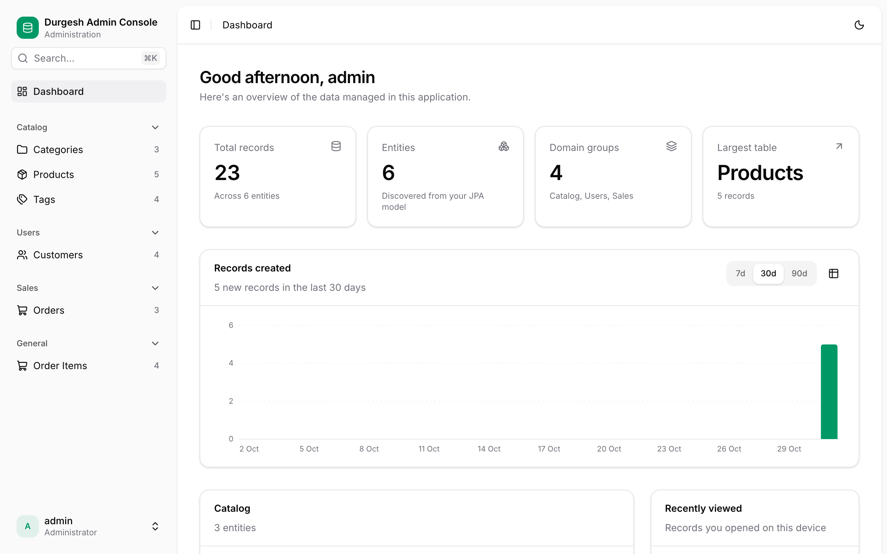
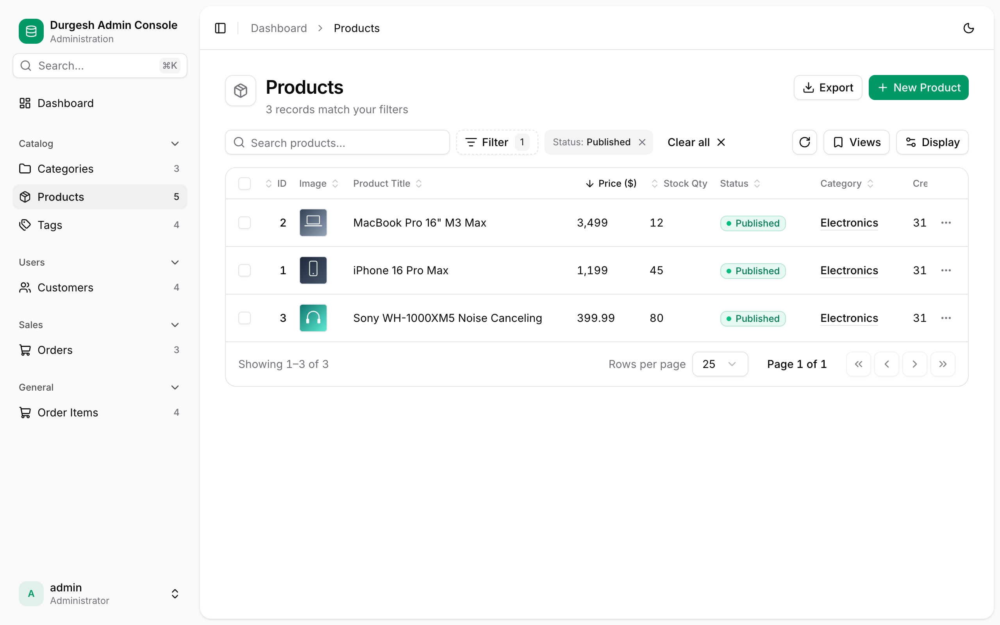
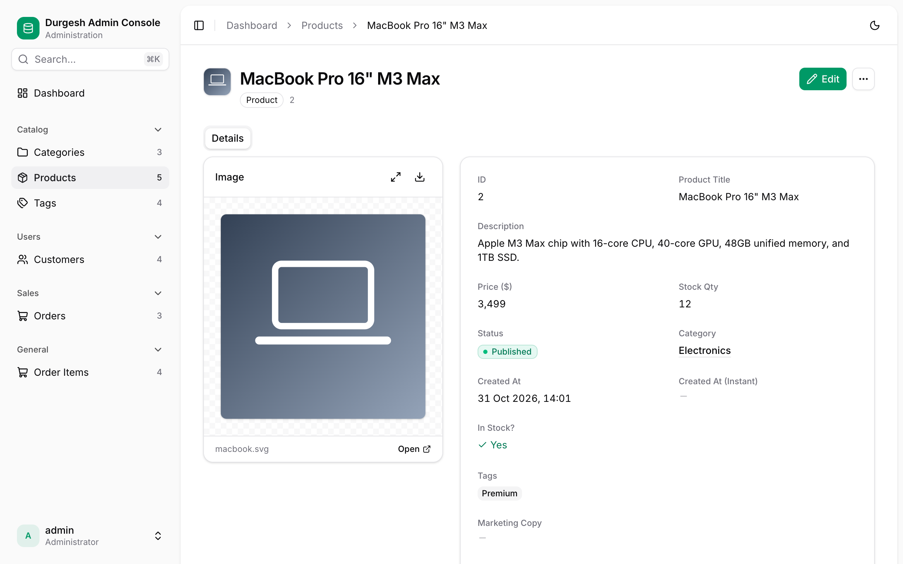
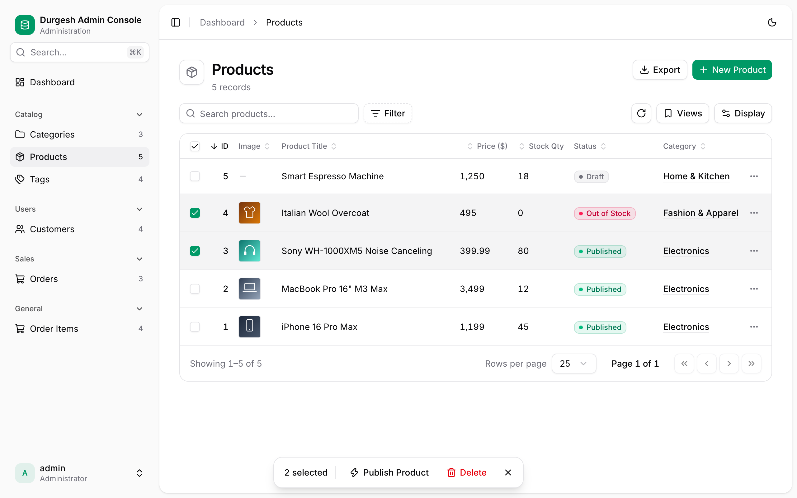

# Spring Boot JPA Admin

A Spring Boot starter that discovers JPA entities and generates an administration console for browsing, creating, updating, and deleting records. The React UI is embedded in a JAR and served by your Spring application at `/admin/`.

[](https://substring-projects.github.io/jpa-admin/)
[](https://github.com/durgeshcoder)

- 📖 **Documentation:** [https://substring-projects.github.io/jpa-admin/](https://substring-projects.github.io/jpa-admin/)
- 👤 **Creator Profile:** [Durgesh Tiwari (@durgeshcoder)](https://github.com/durgeshcoder)

**Published:** `0.1.0` · **Development:** `0.2.0-SNAPSHOT` · **Java:** 17+ · **Spring Boot:** 4.0.0

[Documentation](https://substring-projects.github.io/jpa-admin/) · [Website setup](docs/publishing-docs.md) · [Installation](docs/installation.md) · [API reference](docs/api-reference.md) · [Contributing](CONTRIBUTING.md)

## Screenshots

| Dashboard Overview | Entity Table & Search |
| :---: | :---: |
|  |  |

| Record Detail | Bulk Selection & Deletions |
| :---: | :---: |
|  |  |

## Key Features & Capabilities

### ⚛️ Smooth Single Page Application (SPA) with React & Tailwind CSS
- **Modern React 19 & Vite Stack:** True Single Page Application architecture delivering instantaneous client-side navigation without full-page reloads.
- **Fluid & Responsive UI:** Crafted with **Tailwind CSS** and **Radix UI** primitives for a polished, modern look across desktop, tablet, and mobile screens (with collapsible drawer navigation).
- **Instant Light & Dark Theme:** Smooth, flicker-free toggling between Slate Light and Onyx Dark modes with persistent user preferences.
- **Micro-Interactions & Feedback:** Skeleton loading placeholders, live toast notifications, and interactive modals for create, edit, view, and delete operations.

### ⚡ Instant JPA Entity Discovery & Full CRUD
- **Zero-Configuration Metamodel Introspection:** Automatically scans and discovers all JPA `@Entity` classes at boot time without boilerplate code.
- **Dynamic Data Grids:** Server-side pagination, adjustable page sizes, multi-column sorting, and debounced text-field search.
- **Filters & Saved Views:** Text, enum and boolean filters, searchable relation filters, and min/max or from/to ranges for numbers and dates. Filters show as removable chips, and any search/filter/sort combination can be saved as a named view.
- **Edit in Place:** Change a status, number, date or relation straight from the table without opening the form.
- **Smart Form Generation:** Type-aware form controls for string inputs, text areas, datetime formatters, toggle switches for booleans, and enum selects.

### 🔗 Intelligent Relationship Management
- **Searchable Foreign Keys:** Automatically resolves `@ManyToOne` and `@OneToOne` associations into asynchronous, searchable select dropdowns.
- **Descriptive Entity Labels:** Displays human-readable labels derived from entity `toString()` or marked `@AdminField` identifier instead of raw database IDs.
- **Editable Inline Collections:** `@AdminInline` one-to-many rows (such as order line items) are added, edited and removed inside the parent form and saved in one transaction.
- **Many-to-Many Multi-Select:** Owning-side `@ManyToMany` fields are edited with a searchable multi-select.
- **File & Image Uploads:** `@AdminUpload` adds drag-and-drop uploads with previews, live progress (percentage, speed, time left) and cancel. Files go to a local folder, Amazon S3 (or MinIO/R2) or ImageKit, chosen in configuration.
- **Field-Level Validation:** Bean-validation errors from the server appear next to the exact field, including cells in inline rows.

### 🛡️ Authentication, Permissions & Session Management
- **Dedicated Admin Identity (0.2.0-SNAPSHOT):** Optional users/groups, entity permissions and H2/PostgreSQL/MySQL persistence, separate from host application users.
- **Cookie-Backed Authentication:** Dedicated, styled session login portal with configurable administrator credentials.
- **Automated CSRF Protection:** Seamless CSRF token rotation and validation for all state-changing operations (POST, PUT, DELETE).
- **Sensitive Field Masking:** Password and secret fields are automatically masked with reveal toggles and protected against accidental blank overwrites.

### 🎨 Declarative Customization via Annotations
- **`@AdminResource`:** Configure custom display names, entity icons, default sorting rules, read-only mode, and domain groupings.
- **`@AdminField`:** Control field ordering, custom display names, form widgets (textarea, toggle, date picker), and read-only/hidden visibility.
- **`@AdminBadge`:** Map entity status values and enums to clean, color-coded badges (success, warning, destructive, info).
- **`@AdminAction`:** Register custom business actions and workflow operations directly on domain records.

### ⌨️ Keyboard-First
- **Command palette (⌘K)** to jump to any entity, recent record or action; `/` to search, `n` for a new record, `j`/`k` to move between rows, `e` to edit, and `?` for the full shortcut list.

### 🗂️ Batch Operations & Safe Deletions
- **Multi-Record Selection:** Check individual rows or use select-all to perform bulk operations across tables.
- **Safety Confirmation Modals:** Destructive actions prompt explicit confirmation dialogs to prevent accidental data loss.

### 📦 Zero Runtime Node.js Dependency
- **Self-Contained Starter:** Pre-compiled React frontend assets are packaged in the `jpa-admin-ui` JAR pulled in by the starter and served from the classpath at `/admin/`. No Node.js or npm required in production environments!

### 🔌 Headless REST Management API
- **Exposed REST Endpoints:** Complete API exposed under `/admin/api/**` providing metadata introspection (`/admin/api/metadata`) and CRUD operations for programmatic integration.

Configured mode gives one trusted administrator full access. Optional database mode enforces entity permissions through users and groups; row-level and field-level permission grants are not implemented. Read [security](docs/security.md) and [feature limitations](docs/limitations.md) before exposing application data. CSV export and editable inline collections are supported; XLSX export is not.

## Run the sample

Prerequisites: JDK 17+, Node.js 20+, and npm on `PATH`. The included Maven Wrapper downloads Maven 3.9.9 on first use.

```bash
npm ci --prefix jpa-admin-ui
npm test --prefix jpa-admin-ui
./mvnw clean package
java -jar jpa-admin-sample-app/target/jpa-admin-sample-app-0.2.0-SNAPSHOT.jar
```

On Windows, replace `./mvnw` with `mvnw.cmd`.

Open **http://localhost:8080/admin/** and sign in with **admin / admin**. These credentials are sample defaults only. The sample uses an in-memory H2 database, so changes are lost when it restarts.

To integrate the starter into your own application, follow [installation](docs/installation.md), then [configuration](docs/configuration.md). The starter itself has no usable default password.

## Learn more

| For | Read |
| --- | --- |
| Application developers | [Installation](docs/installation.md), [configuration](docs/configuration.md), [entity customization](docs/entity-customization.md) |
| Administrators | [User guide](docs/user-guide.md), [deployment](docs/deployment.md), [troubleshooting](docs/troubleshooting.md) |
| API clients | [REST API reference](docs/api-reference.md), [authentication](docs/security.md) |
| Contributors | [Architecture](docs/architecture.md), [development](docs/development.md), [contributing](CONTRIBUTING.md) |
| Maintainers | [Release guide](docs/releasing.md) |

The [requirements document](PROJECT_REQUIREMENTS.md) records product plans; it is not a list of completed features. See [installation](docs/installation.md) for Central publication status and dependency coordinates. Licensed under [Apache-2.0](LICENSE).

## Creator

Created and maintained by **[Durgesh Tiwari](https://github.com/durgeshcoder)** ([@durgeshcoder](https://github.com/durgeshcoder)).

### Using your own Spring Security or JWT authentication

The admin owns its configured path (default `/admin/**`) with a security chain at order `-100`, including its UI assets. Your APIs keep their own security chains and authentication. Admin authentication and CSRF state are isolated from the host login; admin logout preserves the host session. Reserve the admin prefix, order host chains after it or exclude it, and keep custom JWT filters out of global servlet registration. See [security integration](docs/security.md#coexisting-with-host-spring-security) for examples and shared-session limits.

### Database admin users and groups

Opt into `spring.jpa.admin.security.mode=database` with the optional `jpa-admin-identity` module for users, groups, and enforced entity permissions on H2, PostgreSQL or MySQL 8.0+. The default configured account remains supported. See [setup, permission semantics, migration and API contract](docs/permissions.md).


## Choose your next step

| Goal | Guide |
| --- | --- |
| Make the console useful for your team | [Practical setup and best use](docs/practical-guide.md) |
| Configure H2, PostgreSQL or MySQL identities | [Identity database setup](docs/database-setup.md) |
| Understand modes, dependency removal and group grants | [Users and permissions](docs/permissions.md) |
| Support another database or a dedicated admin store | [Custom identity stores](docs/custom-identity.md) |
| Fix missing groups, denied writes or stale UI | [Troubleshooting](docs/troubleshooting.md) |

Identity guides describe the current **0.2.0-SNAPSHOT source build**; do not assume the documented 0.1.0 published artifacts include these features. The normal sample bootstraps only `admin`, with no groups. The optional `identity-demo` profile provides viewer/editor accounts; see [the sample walkthrough](docs/getting-started.md#try-users-and-groups).
