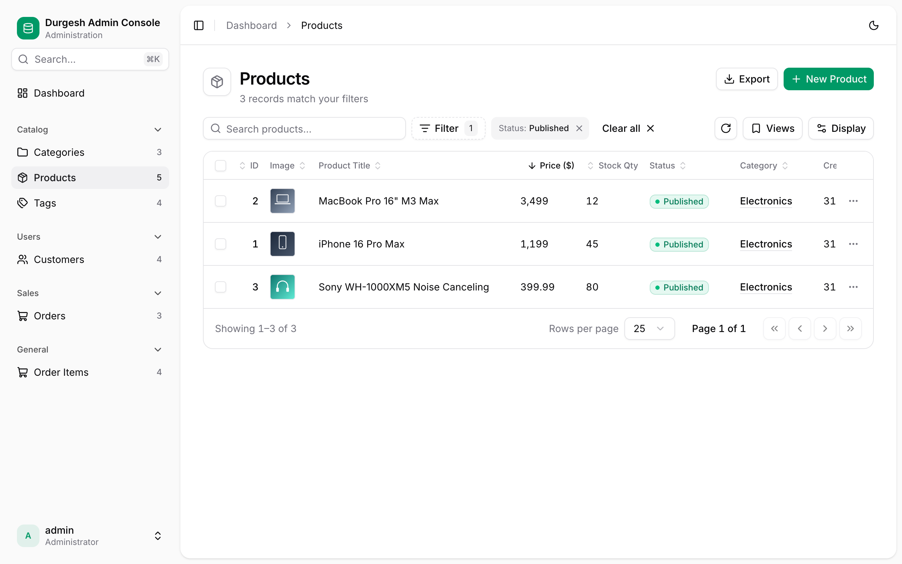
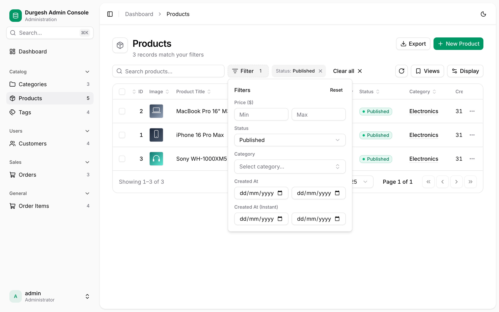
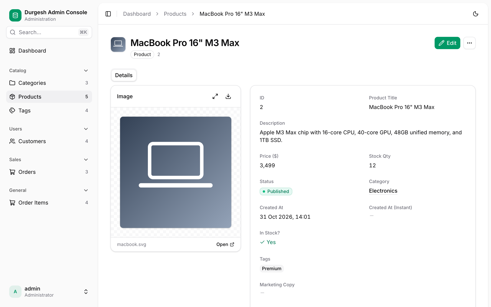
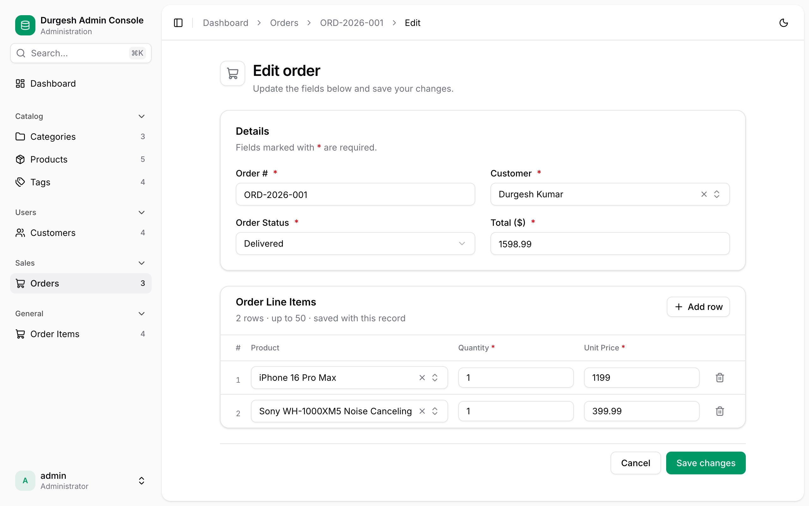
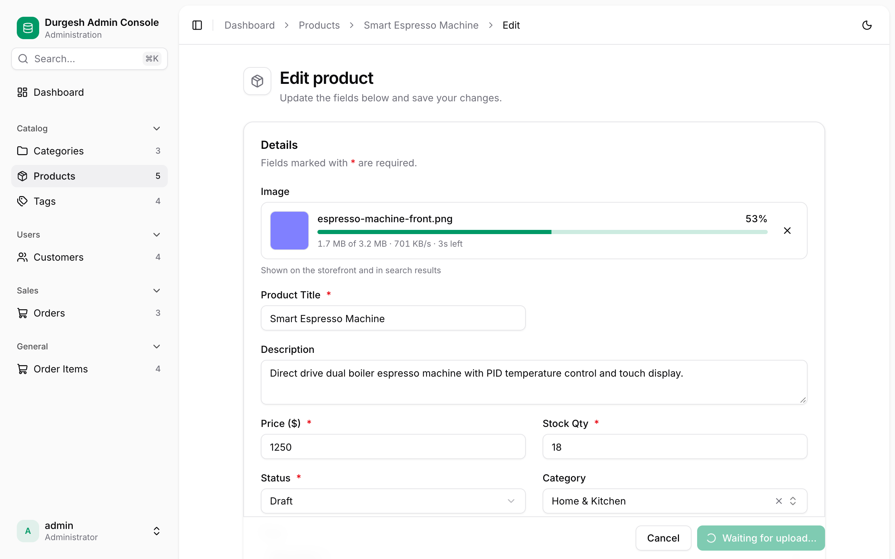
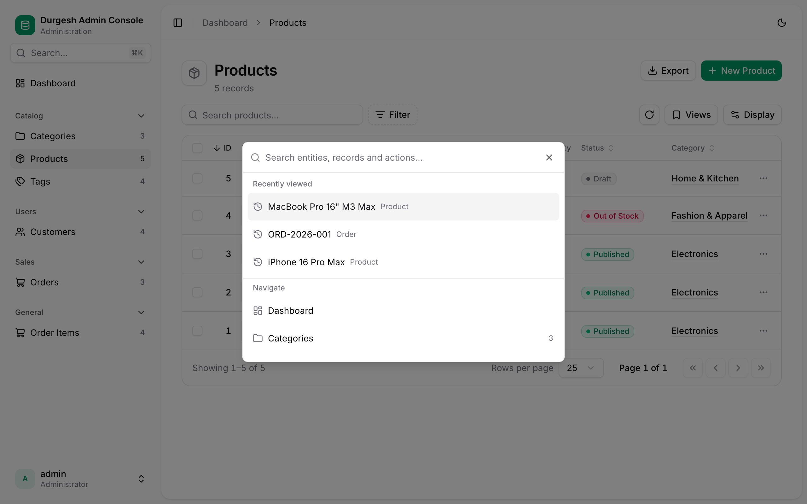
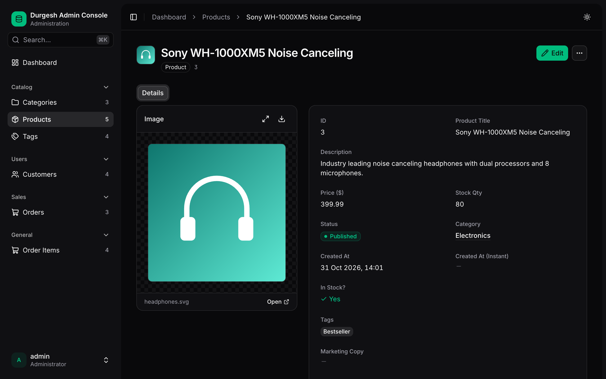

# Spring Boot JPA Admin

!!! note "Documentation version"
    Identity, group permissions and multi-database setup describe the **0.2.0-SNAPSHOT source build**. See [installation](installation.md) for the distinction from the 0.1.0 release.

    Start with [practical setup](practical-guide.md), [database configuration](database-setup.md), or [custom identity stores](custom-identity.md).

## Everything an admin console needs, out of the box { .jpa-center }

<p class="jpa-section-intro">Your JPA entities become a full console at startup. Annotations fine-tune it when you want more control, and everything else just works.</p>

<div class="grid cards" markdown>

-   :material-table-search: __Tables that scale__

    ---

    Server-side search, sorting and pagination, sticky columns, column and density options, and CSV export. Every view is a shareable URL.

-   :material-filter-variant: __Filters & saved views__

    ---

    Relation pickers, number and date ranges, enum and boolean filters, removable chips, and named views you can return to in one click.

-   :material-pencil-box-outline: __Edit anywhere__

    ---

    Full forms with inline validation, edit-in-place cells, duplicate, bulk actions, and an unsaved-changes guard.

-   :material-source-branch: __Real relationships__

    ---

    Searchable many-to-one pickers, many-to-many multi-selects, and one-to-many child rows edited and saved with their parent.

-   :material-cloud-upload-outline: __File & image uploads__

    ---

    Drag and drop with live progress straight to Amazon S3, ImageKit or a local folder. Every file is verified by its content.

-   :material-shield-lock-outline: __Secure by default__

    ---

    Session login with CSRF protection, server-side validation with field-level errors, signed upload tickets, and sanitized rich text.

-   :material-keyboard-outline: __Keyboard-first__

    ---

    A ++cmd+k++ command palette plus shortcuts to search, create, move between rows and edit, without touching the mouse.

-   :material-palette-outline: __Your brand__

    ---

    Your title, logo and accent color, a custom URL path, and light, dark and system themes. No frontend build required.

</div>

## See it in action { .jpa-center }

=== "Data table"

    { .jpa-screenshot loading=lazy }

=== "Filters"

    { .jpa-screenshot loading=lazy }

=== "Record page"

    { .jpa-screenshot loading=lazy }

=== "Inline rows"

    { .jpa-screenshot loading=lazy }

=== "Uploads"

    { .jpa-screenshot loading=lazy }

=== "Command palette"

    { .jpa-screenshot loading=lazy }

=== "Dark mode"

    { .jpa-screenshot loading=lazy }

## Up and running in three steps { .jpa-center }

<div class="jpa-steps" markdown>

### Add the starter

Add the starter dependency from Maven Central. See [Installation](installation.md) for Maven, Gradle and local builds.

```kotlin title="build.gradle.kts"
repositories { mavenCentral() }
dependencies { implementation("com.substringtechnologies:jpa-admin-spring-boot-starter:0.1.0") }
```

### Set an admin password

```yaml title="application.yml"
spring:
  jpa:
    admin:
      security:
        username: admin
        password: ${ADMIN_PASSWORD}
```

### Open the console

Start your application and open **`http://localhost:8080/admin/`**. Every JPA entity is already there.

</div>

<div class="jpa-cta" markdown>

## Make it yours

Rename labels, group entities, color statuses, add actions and uploads, all with annotations on the entities you already have.

[Customize entities :octicons-arrow-right-16:](entity-customization.md){ .md-button .md-button--primary }
[Annotation reference](annotations.md){ .md-button }

</div>
