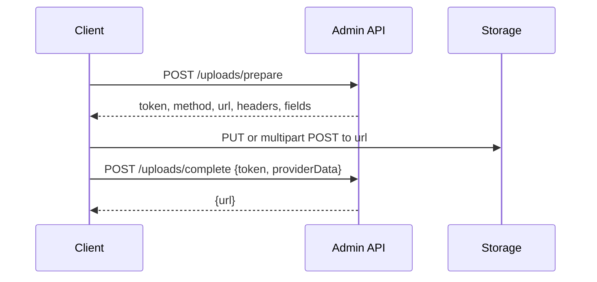

# REST API

<p class="jpa-lead">The console is built entirely on a JSON API that you can also call from scripts and other tools. All paths are relative to <code>{path}/api</code>; with the default path, that's <code>/admin/api</code>.</p>

## Authentication

The API uses the same session and CSRF protection as the console.

| Method | Path | Description |
| --- | --- | --- |
| `GET` | `/auth/session` | Public. Session state and a CSRF token. |
| `POST` | `/auth/login` | Public. Form fields `username` and `password`, plus the CSRF header. Returns `204` with a new session cookie, or `401`. |
| `POST` | `/auth/logout` | Ends the session. Requires the CSRF header. Returns `204`. |

```json title="GET /admin/api/auth/session"
{
  "authenticated": false,
  "username": "",
  "title": "Acme Back Office",
  "csrfHeader": "X-CSRF-TOKEN",
  "csrfToken": "6Y1x…",
  "logoUrl": "",
  "primaryColor": "#2563eb",
  "exportEnabled": true
}
```

??? example "Complete session with curl"
    ```bash
    BASE=http://localhost:8080/admin/api
    JAR=$(mktemp)

    # 1. Get a CSRF token (stores the session cookie)
    TOKEN=$(curl -s -c "$JAR" -b "$JAR" "$BASE/auth/session" | jq -r .csrfToken)

    # 2. Sign in (the session rotates, so fetch a fresh token afterwards)
    curl -s -c "$JAR" -b "$JAR" -H "X-CSRF-TOKEN: $TOKEN" \
         --data-urlencode "username=admin" --data-urlencode "password=$ADMIN_PASSWORD" \
         "$BASE/auth/login" -o /dev/null -w "%{http_code}\n"     # 204
    TOKEN=$(curl -s -c "$JAR" -b "$JAR" "$BASE/auth/session" | jq -r .csrfToken)

    # 3. Read and write
    curl -s -b "$JAR" "$BASE/Product?size=5&sort=price,desc" | jq '.content[].name'
    curl -s -b "$JAR" -X PUT -H "X-CSRF-TOKEN: $TOKEN" -H "Content-Type: application/json" \
         -d '{"stockQuantity": 42}' "$BASE/Product/1" | jq .stockQuantity
    ```

Every endpoint below requires a signed-in session. `POST`, `PUT` and `DELETE` also require the CSRF header.

## Endpoints

| Method | Path | Description |
| --- | --- | --- |
| `GET` | `/metadata` | Every entity: fields, types, labels, relations, inlines, actions, upload rules and flags. |
| `GET` | `/stats` | `{"counts": {"Product": 5, …}}`: record count per entity. |
| `GET` | `/stats/timeline?days=30` | Records created per day (1–365 days) for entities with a creation timestamp. |
| `GET` | `/{entity}` | A page of records, with search, sort and filters ([below](#listing-records)). |
| `GET` | `/{entity}/{id}` | One record, including inline rows and many-to-many references. |
| `POST` | `/{entity}` | Create a record. Returns `201` with the saved record. |
| `PUT` | `/{entity}/{id}` | Update the fields you send. Returns the saved record. |
| `DELETE` | `/{entity}/{id}` | Delete a record. Returns `204`. |
| `POST` | `/{entity}/batch-delete` | JSON array of IDs. Returns `{"deleted": 2}`. |
| `GET` | `/{entity}/lookup?q=&limit=20` | Options for relation pickers: `[{"id": 1, "label": "Electronics"}]`. |
| `POST` | `/{entity}/actions/{actionId}` | Run a custom action on a JSON array of IDs. Returns `{"success": true, "result": …}`. |
| `POST` | `/uploads/prepare` | Start a file upload ([below](#uploads)). |
| `PUT` | `/uploads/local/{token}` | Send the file body to local storage. |
| `POST` | `/uploads/complete` | Verify an upload and get its URL. |

`{entity}` is the JPA entity name (usually the class name, such as `Product`). Action IDs come from `/metadata`; don't derive them from the display name.

## Listing records

```http
GET /admin/api/Product?page=0&size=25&sort=price,desc&q=pro&category=1&price__gte=100&createdAt__lte=2026-12-31
```

| Parameter | Description |
| --- | --- |
| `page` | Zero-based page index. Default `0`. |
| `size` | Page size. Default `25`. |
| `sort` | `field,asc` or `field,desc`. Defaults to the entity's `defaultSortBy` / `defaultSortDir`. |
| `q` (or `search`) | Case-insensitive substring search across searchable text fields. |
| `field=value` | Filter on a field. **Text:** substring, case-insensitive. **Enum, boolean, number:** exact. **Single relation:** the related record's ID. **Date-only value on a date-time field:** that whole day. |
| `field__gte`, `field__lte` | Inclusive lower and upper bounds for numbers, dates and date-times. A date-only `__lte` on a date-time field includes the whole day. |

Invalid filter values return `400` with a message such as `Invalid filter value for Price ($): lots`.

```json title="Response"
{
  "content": [
    { "id": 2, "name": "MacBook Pro 16\" M3 Max", "price": 3499.00, "status": "PUBLISHED",
      "category": { "id": 1, "label": "Electronics" }, "createdAt": "2026-10-31T13:54:12.1" }
  ],
  "totalElements": 1,
  "pageNumber": 0,
  "pageSize": 25,
  "totalPages": 1
}
```

Relations are returned as `{ "id", "label" }`. Sensitive values are returned as `"••••••••"`.

## Write payloads

```json title="POST /admin/api/Order"
{
  "orderNumber": "ORD-2026-104",
  "customer": { "id": 1 },
  "status": "PENDING",
  "totalAmount": 1598.99,
  "items": [
    { "product": { "id": 1 }, "quantity": 1, "unitPrice": 1199.00 },
    { "product": { "id": 3 }, "quantity": 1, "unitPrice": 399.99 }
  ]
}
```

| Field type | Send |
| --- | --- |
| Scalars | JSON values; numbers may be strings. Dates as `2026-10-31`, date-times as `2026-10-31T14:30:00`. Enums by name. |
| Single relation | An ID or `{ "id": … }`; `null` clears it. The related record must exist. |
| Many-to-many (owning side) | An array of IDs or `{ "id": … }` objects; replaces the collection. |
| Inline collection | An array of child objects. Rows **with** the child's ID are updated, rows **without** one are created (if `canAdd`), and rows you leave out are removed (if `canDelete`). At most `limit` rows. |
| Sensitive field | Omit it to keep the current value. Never send the mask back. |

`PUT` only changes the fields you send. Primary keys, read-only fields, computed values and creation timestamps are ignored on update. Every create and update runs Bean Validation on the entity and its inline rows before saving, and nothing is saved if anything fails.

## Uploads



```json title="POST /admin/api/uploads/prepare"
{ "entity": "Product", "field": "imageUrl", "fileName": "front.png", "contentType": "image/png", "size": 482113 }
```

```json title="Response"
{
  "token": "eyJzIjoi…",
  "method": "PUT",
  "url": "https://acme-uploads.s3.ap-south-1.amazonaws.com/products/2026/10/3f2c1a9e-front.png?X-Amz-…",
  "headers": { "Content-Type": "image/png" },
  "fields": {},
  "fileField": null
}
```

- **`PUT`:** send the raw file as the body with exactly these headers. For a same-site URL (local storage), also send the CSRF header.
- **`POST`:** send `multipart/form-data` with every entry of `fields`, then the file under `fileField` (ImageKit).

Then complete it. For ImageKit, pass the `fileId` from ImageKit's response:

```json title="POST /admin/api/uploads/complete"
{ "token": "eyJzIjoi…", "providerData": { "fileId": "6721f…" } }
```

```json title="Response"
{ "url": "https://cdn.acme.com/products/2026/10/3f2c1a9e-front.png" }
```

Save the URL on the record with a normal `PUT` or `POST`.

## Errors

Errors use `{"error": "message"}`, plus `fieldErrors` for validation:

```json title="422 Unprocessable Entity"
{
  "error": "Please correct the highlighted fields",
  "fieldErrors": {
    "price": "must be greater than 0",
    "items[0].quantity": "must be greater than 0",
    "customer": "The selected record no longer exists"
  }
}
```

| Status | Meaning |
| --- | --- |
| `400` | Invalid filter or request, a disabled operation (for example creating when `creatable = false`), or an action that failed. |
| `401` | Not signed in, or the session expired. Also wrong credentials on login. |
| `403` | Missing or stale CSRF token, or a forged upload ticket. |
| `404` | Unknown entity, record or upload. |
| `409` | Database constraint violation, such as a duplicate unique value or a record still referenced elsewhere. |
| `410` | The upload ticket expired (after 30 minutes). |
| `413` | The file is larger than the field's `maxSize`. |
| `415` | The file type isn't in the field's `accept` list. |
| `422` | Validation failed (`fieldErrors`), or uploaded content doesn't match its declared type. |
| `502` | The file storage couldn't be reached. |
