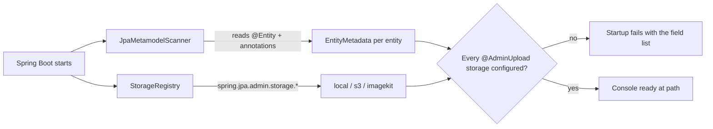
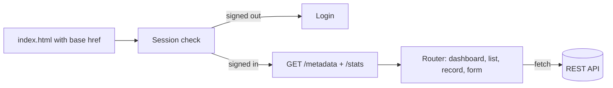

# Architecture

<p class="jpa-lead">How the pieces fit together, for contributors and anyone curious about what runs inside their application.</p>

## Modules

```text
jpa-admin/
├── jpa-admin-core/                       Annotations, metadata scanner, CRUD service, REST API, file storage
├── jpa-admin-spring-boot-autoconfigure/  Properties, security chain, UI serving, beans
├── jpa-admin-ui/                         React app, packaged as static files in a JAR
├── jpa-admin-spring-boot-starter/        The one dependency applications add
├── jpa-admin-sample-app/                 Demo shop with every feature, plus integration tests
├── docs/ · overrides/ · mkdocs.yml       This documentation site
└── pom.xml                               Maven reactor (groupId com.substringtechnologies)
```

## At startup



- **`JpaMetamodelScanner`** reads the JPA metamodel and the admin annotations to build `EntityMetadata`: fields, types, labels, relations, inlines, actions, validation and upload rules.
- **`DynamicCrudService`** turns metadata into queries (filters, search, sorting, paging), binds and validates payloads, saves inline rows and many-to-many collections, runs actions, and computes stats.
- **`AdminApiController`** and **`AdminUploadController`** expose the [REST API](api-reference.md) at `{path}/api`.
- **`JpaAdminSecurityConfiguration`** registers a dedicated filter chain for `{path}/api/**` with session login and CSRF.
- **`JpaAdminWebMvcConfigurer`** serves the UI at `{path}/**`, falls back to `index.html` for client-side routes, writes the configured base path into the page, and serves local upload folders.

## In the browser



The UI is a React 19 single-page app built with Vite, Tailwind CSS 4 and shadcn/ui (Radix primitives). Every screen is generated from `/metadata`; nothing is entity-specific.

| Area | Location |
| --- | --- |
| Routes | `src/router.tsx`: `/`, `/:entity`, `/:entity/new`, `/:entity/:id`, `/:entity/:id/edit` |
| App shell | `src/components/layout/`: sidebar, header and breadcrumbs, command palette, shortcuts |
| Pages | `src/views/`: dashboard, list, detail, form, login |
| Value display | `src/components/CellValue.tsx`, `src/lib/format.ts` |
| Inputs | `src/components/FieldInput.tsx` (shared by forms, inline rows and edit-in-place) |
| Uploads | `src/components/FileUpload.tsx`, `src/api/uploads.ts` |
| Base path | `src/lib/base-path.ts` reads the `<base href>` the server writes |
| shadcn components | `src/components/ui/` |

## Packaging

`npm run build` writes the UI to `jpa-admin-ui/dist/`, and Maven copies it into the UI JAR under `META-INF/resources/admin/`. The build uses relative asset URLs, and the server rewrites the page's `<base href>` to the configured `path`, so one build serves any path. Heavy pieces (the rich-text editor, the code editor and the full icon set) are split into chunks that only load when used.

JitPack builds skip npm and package the committed `dist/`, so commit the rebuilt `dist` together with UI source changes.
