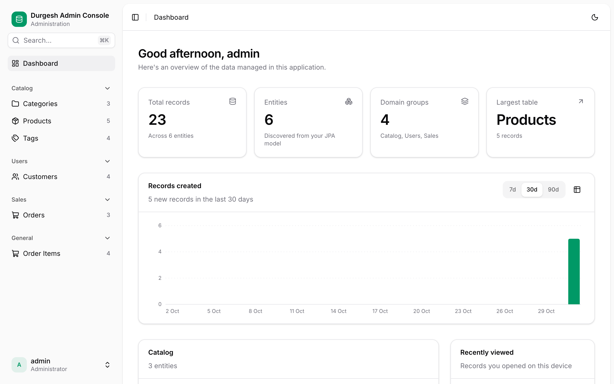
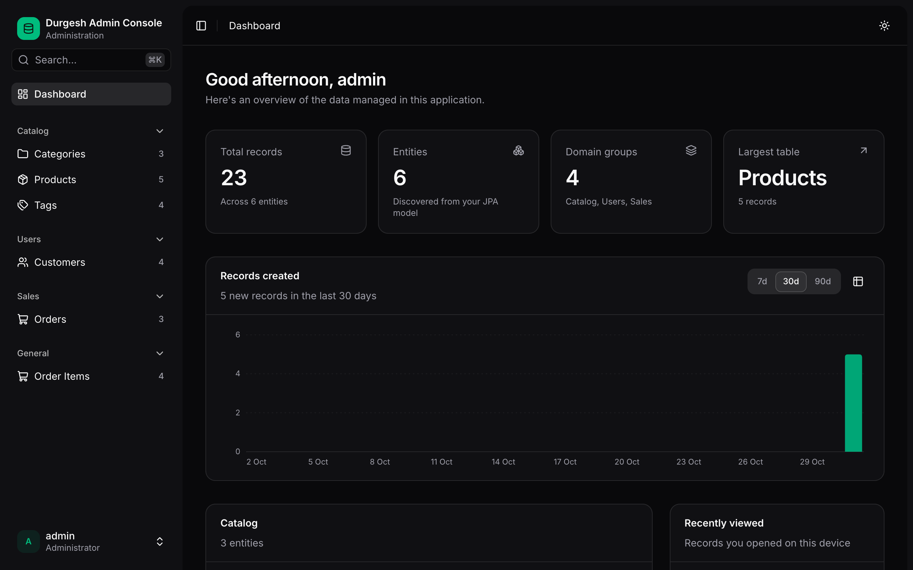

# Branding & theming

<p class="jpa-lead">Make the console look like part of your product: name, logo, accent color, URL and theme. All of it is configuration, so you never rebuild the UI.</p>

## Name and logo

```yaml
spring:
  jpa:
    admin:
      title: "Acme Back Office"
      logo-url: /images/acme-logo.svg     # or https://cdn.acme.com/logo.png
```

- **`title`** appears on the login page, at the top of the sidebar, and as the browser tab title.
- **`logo-url`** replaces the default database mark in the sidebar and on the login page. Square images look best, displayed at 32×32. If the image fails to load, the default mark is shown.

## Accent color

```yaml
spring.jpa.admin.primary-color: "#2563eb"
```

The color is used for primary buttons, focus rings, checkboxes and switches, progress bars, the brand mark and the dashboard chart. Text on top of it switches between black and white automatically for readable contrast. Only `#rrggbb` hex values are accepted; anything else falls back to the default emerald, so a typo can't break the page.

| `primary-color` | Result |
| --- | --- |
| *(not set)* | Emerald (default) |
| `#2563eb` | Blue |
| `#7c3aed` | Violet |
| `#ea580c` | Orange |
| `#0f172a` | Near-black (white text on buttons) |

## URL path

```yaml
spring.jpa.admin.path: /backoffice
```

The console moves to `/backoffice/` and its API to `/backoffice/api`. The prebuilt UI adapts automatically, because the server tells it its base path. The value must start with `/` and have no trailing slash, and it can't be `/`.

## Themes

Users choose **Light**, **Dark** or **System** (follows the operating system) from the account menu or the ⌘K palette. The choice is saved per browser and applied before the page draws, so there's no flash of the wrong theme. Your accent color is used in both themes.

<div class="grid" markdown>

{ .jpa-screenshot loading=lazy }

{ .jpa-screenshot loading=lazy }

</div>

## Entity names and icons

Per-entity branding lives on the entities:

```java
@AdminResource(displayName = "Invoice", pluralName = "Invoices", group = "Billing", icon = "receipt")
```

Icons are [Lucide](https://lucide.dev/icons) names. See [Customizing entities](entity-customization.md#name-group-and-order-entities).
