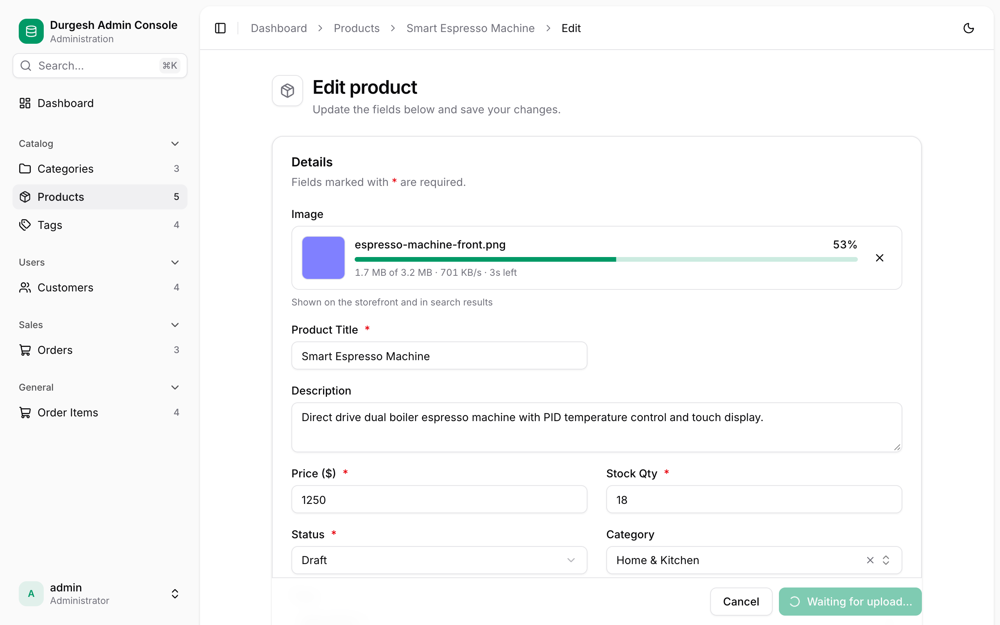
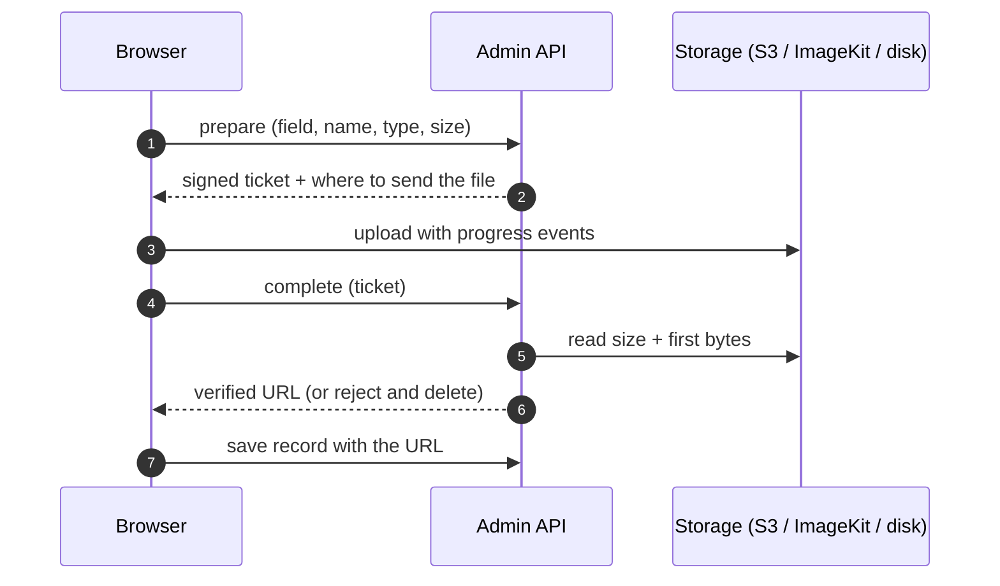

# File & image uploads

<p class="jpa-lead">Annotate a <code>String</code> field with <code>@AdminUpload</code> and it becomes a drag-and-drop uploader with live progress. Files go to a local folder, Amazon S3 (or any S3-compatible service) or ImageKit. Switching provider is a configuration change only.</p>

<figure markdown>
{ .jpa-screenshot loading=lazy }
</figure>

## Quick start

<div class="jpa-steps" markdown>

### Annotate the field

```java
@Column(length = 500)
@AdminField(label = "Image")
@AdminUpload(folder = "products", maxSize = "5MB")
private String imageUrl;   // stores the uploaded file's URL
```

### Configure a storage

```yaml title="application.yml"
spring:
  jpa:
    admin:
      storage:
        default:            # used by every @AdminUpload without a storage name
          type: local
          directory: ./uploads
          public-path: /uploads
```

### Upload

Open a record and drag an image onto the field. The URL (here `/uploads/products/2026/10/3f2c1a9e-front.png`) is saved when you save the record.

</div>

## The annotation

```java
@AdminUpload(
    storage = "default",                       // which configured storage
    folder = "products",                       // key prefix inside the storage
    accept = {"image/png", "image/jpeg"},      // allowed types
    maxSize = "5MB"                            // size limit
)
```

| Option | Default | Notes |
| --- | --- | --- |
| `storage` | `default` | Name under `spring.jpa.admin.storage`. If no such storage is configured, the application **fails at startup** and lists the fields. |
| `folder` | none | Files are stored as `folder/yyyy/MM/<8-char id>-<cleaned original name>.<ext>`: unique, but still readable. |
| `accept` | PNG, JPEG, WebP, GIF | Exact MIME types, or wildcards like `image/*`. **SVG is accepted only when `image/svg+xml` is listed explicitly**, because SVG files can contain scripts. |
| `maxSize` | `5MB` | `500KB`, `10MB`, `1GB` or a byte count. |

When every accepted type is an image, the field shows image previews; otherwise it shows file chips. Examples:

```java
@AdminUpload(accept = "application/pdf", maxSize = "10MB")
private String invoicePdf;

@AdminUpload(accept = {"text/csv", "application/vnd.openxmlformats-officedocument.spreadsheetml.sheet"})
private String importFile;

@AdminUpload(storage = "avatars", accept = "image/*", maxSize = "2MB")
private String avatarUrl;
```

## Storages

Configure one storage named `default`, or as many named storages as you need, and choose one per field with `storage = "…"`. You can mix providers, and have several of the same type (two S3 buckets, for instance).

=== "Local folder"

    ```yaml
    spring.jpa.admin.storage:
      default:
        type: local
        directory: ./uploads        # created at startup
        public-path: /uploads       # URL the folder is served from
    ```

    Uploads stream through the admin API to disk with the size limit enforced, and are served from `public-path`. Use a persistent volume in containers. Local storage isn't shared between instances, so prefer S3 or ImageKit when you scale out.

=== "Amazon S3"

    ```yaml
    spring.jpa.admin.storage:
      default:
        type: s3
        bucket: acme-uploads
        region: ap-south-1
        access-key: ${AWS_ACCESS_KEY_ID}       # omit both keys to use the
        secret-key: ${AWS_SECRET_ACCESS_KEY}   # default AWS credential chain
        public-url: https://cdn.acme.com       # optional CDN in front of the bucket
    ```

    Add the SDK dependency (it's optional, so other applications don't carry it):

    ```xml
    <dependency>
        <groupId>software.amazon.awssdk</groupId>
        <artifactId>s3</artifactId>
        <version>2.46.7</version>
    </dependency>
    ```

    The browser uploads **directly to the bucket** with a presigned URL that's valid for 15 minutes and locked to the exact content type and size, so large files never pass through your server. The bucket needs a CORS rule for your admin's origin:

    ```json
    [{
      "AllowedOrigins": ["https://admin.acme.com"],
      "AllowedMethods": ["PUT"],
      "AllowedHeaders": ["*"],
      "MaxAgeSeconds": 3000
    }]
    ```

    Saved URLs use `public-url` when it's set, otherwise `https://<bucket>.s3.<region>.amazonaws.com/<key>`. Make the objects readable to whoever needs them, through a bucket policy or CloudFront.

=== "MinIO / R2 / Spaces"

    ```yaml
    spring.jpa.admin.storage:
      default:
        type: s3
        bucket: uploads
        region: us-east-1
        endpoint: https://minio.internal:9000   # or your R2 / Spaces endpoint
        path-style: true                          # usually required for MinIO
        access-key: ${S3_ACCESS_KEY}
        secret-key: ${S3_SECRET_KEY}
    ```

    The same S3 provider works with any S3-compatible service. With `path-style`, URLs look like `endpoint/bucket/key`; without it, `bucket.endpoint/key`.

=== "ImageKit"

    ```yaml
    spring.jpa.admin.storage:
      default:
        type: imagekit
        public-key: ${IMAGEKIT_PUBLIC_KEY}
        private-key: ${IMAGEKIT_PRIVATE_KEY}
        url-endpoint: https://ik.imagekit.io/acme
    ```

    The browser uploads **directly to ImageKit** with a short-lived signature (30 minutes) created on your server. The private key never reaches the browser. After the upload, the server confirms the file through ImageKit's API. No extra dependency is needed.

=== "Your own provider"

    Declare a `FileStorage` bean and reference its `type()`:

    ```java
    @Component
    class CloudinaryStorage implements FileStorage {
        public String type() { return "cloudinary"; }
        public UploadTicket prepare(String key, String contentType, long size, String localTicket) { … }
        public StoredObject inspect(String key, Map<String, String> providerData) { … }
        public void delete(String key, Map<String, String> providerData) { … }
    }
    ```

    ```yaml
    spring.jpa.admin.storage:
      default:
        type: cloudinary
    ```

## How an upload works



1. **Prepare.** The server checks the field's `accept` and `maxSize` rules and signs a ticket that expires in 30 minutes. The ticket binds the storage, key, type and size.
2. **Upload.** The browser sends the file straight to the storage (or to the API for local storage) and reports real progress.
3. **Complete.** The server reads the stored file's size and **first bytes** to confirm its real type. A mismatch, such as HTML renamed to `.png`, is **deleted** and rejected with a clear message.
4. **Save.** The returned URL is saved with the record like any other field.

## In the console

- **Empty:** a drop zone that names the allowed types and limit ("PNG, JPEG, WebP or GIF · up to 5 MB").
- **Before uploading:** wrong types and oversized files are rejected instantly, with the reason.
- **Uploading:** a preview, the file name, a progress bar, "1.7 MB of 3.2 MB · 698 KB/s · 3s left", and **Cancel**.
- **Done:** a preview card with **Replace**, **Remove** and **Open**.
- **Errors:** a message with **Retry**.
- **Save** shows "Waiting for upload…" and stays disabled until uploads finish.
- **Tables** show thumbnails or file chips; **record pages** show images in a [media panel](user-guide.md#view-a-record) with a full-size viewer.

## Security

| Protection | Details |
| --- | --- |
| Authentication | Every upload endpoint requires an admin session and a CSRF token. |
| Rules enforced on the server | Type and size are checked when preparing, enforced while streaming (local) or by the signature (S3), and verified after upload. |
| Content sniffing | The real type is detected from the file's bytes. Disguised files are deleted. |
| Signed tickets | HMAC-signed and expiring; a client can't upload to or complete a key it wasn't given. |
| SVG off by default | SVG must be listed explicitly in `accept`. |
| Safe serving (local) | Files are served with `X-Content-Type-Options: nosniff` and a sandboxing `Content-Security-Policy`. |
| Safe links | The console only renders `http(s)` URLs and same-site paths, never `javascript:` or `data:`. |

!!! warning "Uploaded files are public by URL"
    Local `public-path` files are served without authentication, so images can be shown on your storefront. Don't store confidential documents in a public storage; use a private bucket with your own access layer instead.

## Multiple instances

Tickets are signed with a random key generated at startup. Behind a load balancer, give every instance the same key:

```yaml
spring.jpa.admin.upload.signing-key: ${ADMIN_UPLOAD_SIGNING_KEY}
```

Use S3 or ImageKit (or a shared volume) so every instance sees the same files.

## Limits

- One file per field. Galleries and multi-file fields aren't supported yet; use several fields or a child entity with [inline rows](entity-customization.md#one-to-many-child-rows).
- Replacing or removing a file updates the record but **keeps the old file** in storage.
- No resizing or thumbnails. Use ImageKit transformations or your CDN.
