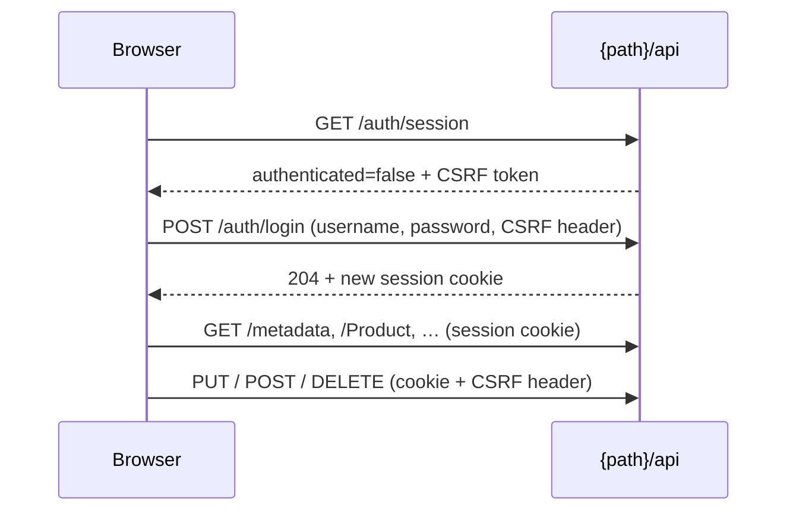

# Security

How sign-in works, what is protected, and what to consider before giving people access.

## Sign-in and sessions

1. The console asks `{path}/api/auth/session` whether you're signed in and receives a CSRF token.
2. Your username and password are checked against the configured account (stored as a BCrypt hash in memory).
3. A session cookie is issued. Credentials are never stored in the browser.
4. Every request that changes data must carry the CSRF token, which the console handles automatically.
5. **Sign out** invalidates the session. An expired session sends you back to the login page.

## What's protected

| Area | Protection |
| --- | --- |
| UI files (`{path}/**`) | Public, so the login page can load. They contain no data. |
| Metadata, records, lookups, stats, actions, uploads (`{path}/api/**`) | Require a signed-in admin (`ROLE_JPA_ADMIN`). |
| Login, logout and every write | Require a valid CSRF token. |
| Local upload files (`public-path`) | **Public by URL**, so images can be used in your storefront. See [File uploads](file-uploads.md#security). |

The starter registers its own Spring Security filter chain for `{path}/api/**` (order `-100`) with its own authentication manager, so it doesn't use or change your application's users. **Your other routes are not secured by the starter**; protect them with your own security configuration.

## Built-in safeguards

- **Validation before save:** Bean Validation runs on every create and update, and rejected changes are rolled back.
- **Flags enforced on the server:** `readOnly`, `creatable`, `updatable`, `deletable`, inline `canAdd`, `canDelete` and `limit`, read-only fields and primary keys are all checked by the API, not just hidden in the UI.
- **Sensitive fields** are masked in every response.
- **Rich text** is sanitized before display, so stored HTML can't run scripts in the console.
- **CSV export** escapes cells that spreadsheets would treat as formulas.
- **Uploads** use signed, expiring tickets, check content, block SVG by default, and are served inert. See [File uploads](file-uploads.md#security).
- **Database errors** such as duplicate keys return a friendly `409` message without SQL details.
- **Configuration values** that end up in pages are validated: `path` (strict format) and `primary-color` (`#rrggbb` only).

## Limits to know

!!! warning "One admin, full access"
    There is a **single admin account** with access to every entity and action. `@AdminPermission` roles are exposed in metadata but **not enforced** yet. Give console access only to people you trust with all the data the console exposes.

- No login rate limiting or account lockout; put the console behind your SSO, VPN or IP allow-list for internet-facing deployments.
- No audit log of who changed what.
- Custom actions run arbitrary entity code with admin rights; validate inside the method.
- The sample app's H2 console (`/h2-console`) is for local demos only and isn't protected by the admin chain.

## Hardening checklist

- [x] Supply the password from a secret (`${ADMIN_PASSWORD}`), never in source control.
- [x] Serve over HTTPS.
- [x] Restrict network access to the console path where possible.
- [x] Use `hidden = true` or `readOnly = true` on entities that shouldn't be editable.
- [x] Use a private or access-controlled storage for confidential files.
- [x] Set `upload.signing-key` when running several instances.
- [x] Disable the H2 console and other demo settings in production.
