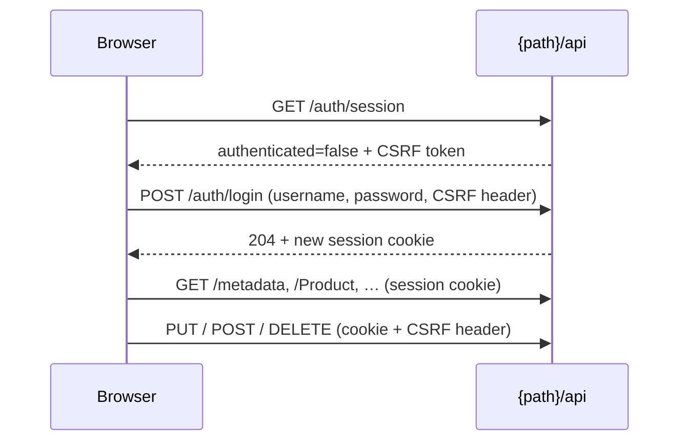

# Security

<p class="jpa-lead">How sign-in works, what is protected, and what to consider before giving people access.</p>

## Sign-in and sessions



1. The console asks `{path}/api/auth/session` whether you're signed in and receives a CSRF token.
2. Your username and password are checked against the configured account (stored as a BCrypt hash in memory).
3. A session cookie is issued. Credentials are never stored in the browser.
4. Every request that changes data must carry the CSRF token, which the console handles automatically.
5. **Sign out** clears only the admin authentication and admin CSRF token. It preserves the servlet session and any host-app login. An expired session sends you back to the login page.

## What's protected

| Area | Protection |
| --- | --- |
| UI shell, frontend routes and files (GET/HEAD under `{path}`, excluding `/api`) | Public, so the login page can load. They contain no entity data. |
| Session status and login (`{path}/api/auth/session`, `/auth/login`) | Accessible before sign-in; login still requires CSRF. |
| Metadata, records, lookups, stats, actions, uploads (`{path}/api/**`) | Require a signed-in admin (`ROLE_JPA_ADMIN`). |
| Login, logout and every write | Require a valid CSRF token. |
| Local upload files (`public-path`) | **Public by URL**, so images can be used in your storefront. See [File uploads](file-uploads.md#security). |

The starter registers its own Spring Security filter chain for `{path}` and `{path}/**` (order `-100`) with its own authentication manager. It covers the UI as well as the API, so a later host catch-all chain does not block the admin login page. **Your other routes are not secured by the starter**; protect them with your own security configuration.

## Coexisting with host Spring Security

Reserve the configured admin prefix for the library. Do not place application controllers inside that prefix: non-API GET/HEAD requests there are public so the frontend can load. Changing `spring.jpa.admin.path` moves both the admin security boundary and the UI/API routes.

- Keep host chains after the admin chain, for example `@Order(0)`, or give them matchers that exclude the admin prefix. Spring Security uses the first matching chain; an earlier catch-all chain can intercept admin requests. Do not put the admin prefix in `web.ignoring()` because that bypasses its protection entirely.
- A host JWT/resource-server chain can remain stateless. The admin uses its own session login and does not accept the host bearer token or automatically reuse the host's users, even if a host user has `ROLE_JPA_ADMIN`.
- Admin authentication and CSRF tokens use dedicated session attributes, scoped to the configured admin path. Admin login preserves host authentication and its CSRF token. Admin logout clears only admin state and does not delete the shared session cookie or invalidate the HTTP session.
- The servlet session is still shared infrastructure. Host logout that invalidates the whole session, or session expiry, also removes the admin login. Admin sign-in can rotate the shared session ID as session-fixation protection. This is authentication-context isolation, not separate sessions or a separate deployment.
- Admin credentials are still required via `spring.jpa.admin.security.username` and `.password`.

For a host JWT filter, prefer installing it only in the host `SecurityFilterChain`. If the filter is also a Spring bean, disable automatic servlet registration so it does not execute globally:

```java
@Bean
FilterRegistrationBean<JwtAuthenticationFilter> jwtFilterRegistration(JwtAuthenticationFilter filter) {
    var registration = new FilterRegistrationBean<>(filter);
    registration.setEnabled(false);
    return registration;
}
```

`FilterRegistrationBean` is from `org.springframework.boot.web.servlet`; `JwtAuthenticationFilter` represents your own filter. Add the filter to your host chain with `addFilterBefore(...)` as usual. If it intentionally runs globally, its `shouldNotFilter` must exclude the configured admin path and descendants (respecting any servlet context path). Checking only `permitAll` rules does not skip a custom filter.

A library cannot override a container filter, an earlier security chain, or reverse-proxy rules that intercept requests before it. Those integrations must respect the reserved prefix. Public upload URLs outside the admin prefix remain subject to host/proxy rules; admin authentication isolation does not make uploaded files private.

## Built-in safeguards

- **Validation before save:** Bean Validation runs on every create and update, and rejected changes are rolled back.
- **Flags enforced on the server:** `readOnly`, `creatable`, `updatable`, `deletable`, inline `canAdd`, `canDelete` and `limit`, read-only fields and primary keys are all checked by the API, not just hidden in the UI.
- **Sensitive fields** are masked in every response.
- **Rich text** is sanitized before display, so stored HTML can't run scripts in the console.
- **CSV export** escapes cells that spreadsheets would treat as formulas.
- **Uploads** use signed, expiring tickets, check content, block SVG by default, and are served inert. See [File uploads](file-uploads.md#security).
- **Database errors** such as duplicate keys return a friendly `409` message without SQL details.
- **Configuration values** that end up in pages are validated: `path` (strict format) and `primary-color` (`#rrggbb` only).

## Limits to know

!!! warning "One admin, full access"
    There is a **single admin account** with access to every entity and action. `@AdminPermission` roles are exposed in metadata but **not enforced** yet. Give console access only to people you trust with all the data the console exposes.

- No login rate limiting or account lockout; put the console behind your SSO, VPN or IP allow-list for internet-facing deployments.
- No audit log of who changed what.
- Custom actions run arbitrary entity code with admin rights; validate inside the method.
- The sample app's H2 console (`/h2-console`) is for local demos only and isn't protected by the admin chain.

## Hardening checklist

- [x] Supply the password from a secret (`${ADMIN_PASSWORD}`), never in source control.
- [x] Serve over HTTPS.
- [x] Restrict network access to the console path where possible.
- [x] Use `hidden = true` or `readOnly = true` on entities that shouldn't be editable.
- [x] Use a private or access-controlled storage for confidential files.
- [x] Set `upload.signing-key` when running several instances.
- [x] Disable the H2 console and other demo settings in production.

## Running security regression checks

Build the packaged app and run backend tests from the repository root:

```sh
mvn package
```

From `jpa-admin-ui`, run the browser suite against a fresh sample app:

```sh
CI=1 E2E_CHANNEL=chrome E2E_PORT=18090 npm run test:e2e -- --retries=0
```

To verify sign-in, logout, CSRF rotation and session loss under both a servlet context and a custom admin prefix:

```sh
CI=1 E2E_CHANNEL=chrome E2E_PORT=18091 E2E_CONTEXT_PATH=/qa E2E_ADMIN_PATH=/internal/console npm run test:e2e -- security.spec.ts --retries=0
```

Use `E2E_CHANNEL=chromium` if using Playwright's installed Chromium instead of Chrome. These runs start and stop their own local server. The backend `JpaAdminHostSecurityTest` separately exercises host signed-JWT and session authentication alongside admin authentication, including preservation of host CSRF tokens across admin login/logout.
