# Using the console

A tour of everything the console does, from signing in to bulk actions. Available controls depend on your permissions, entity configuration and supported field types.

## Sign in

Open `{path}/` (by default `/admin/`) and sign in with the configured admin account or the dedicated admin account assigned to you in database mode. Host-app credentials do not automatically work here. The session lasts until you sign out or it expires; an expired session returns you to the login screen.

<figure markdown>
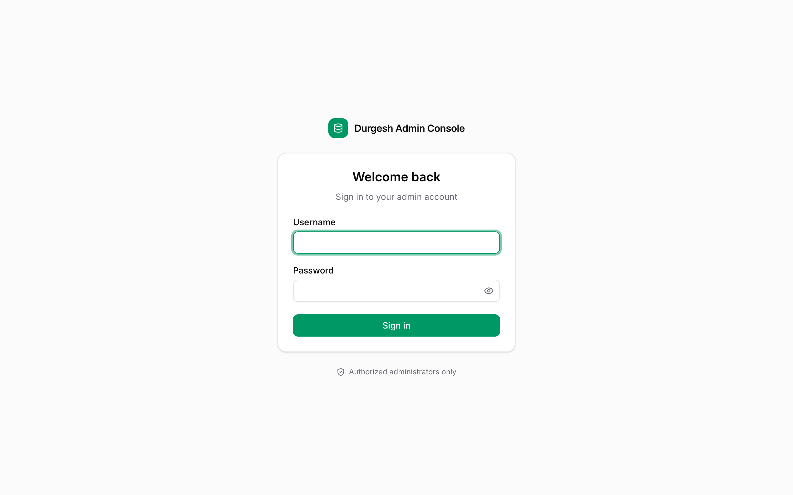{ .jpa-screenshot width="720" loading=lazy }
</figure>

## Find your way around

### Sidebar

- **Entity groups.** Entities are grouped by `@AdminResource(group = …)`. Click a group heading to collapse it; your choice is remembered.
- **Record counts** appear next to each entity.
- **Icons** come from `@AdminResource(icon = …)`. Without one, a fitting icon is picked from the entity name (orders get a cart, users get people, and so on).
- **Collapse** the sidebar to icons with the button in the header, or ++cmd+b++ / ++ctrl+b++. On phones it opens as a drawer.
- **Account menu** (bottom): switch between Light, Dark and System theme, or sign out.

### Command palette

Press ++cmd+k++ (++ctrl+k++ on Windows and Linux), or click **Search…** in the sidebar, to jump anywhere:

- **Recently viewed** records
- **Navigate** to the dashboard or any entity (with record counts)
- **Create** a new record of any type
- **Help**: the keyboard shortcut list
- **Theme**: light, dark or system

<figure markdown>
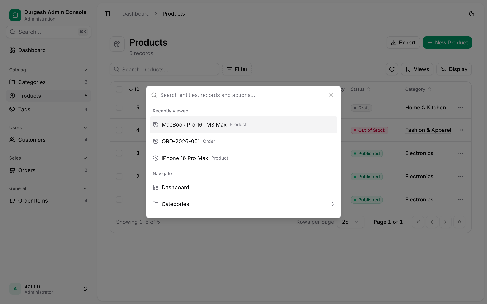{ .jpa-screenshot loading=lazy }
</figure>

### Breadcrumbs and links

The header shows where you are (*Dashboard › Products › MacBook Pro › Edit*). Every page has its own URL, including the search, filters, sort order and page of a table, so you can bookmark it, share it, refresh it or use the browser's Back button.

## Dashboard

<figure markdown>
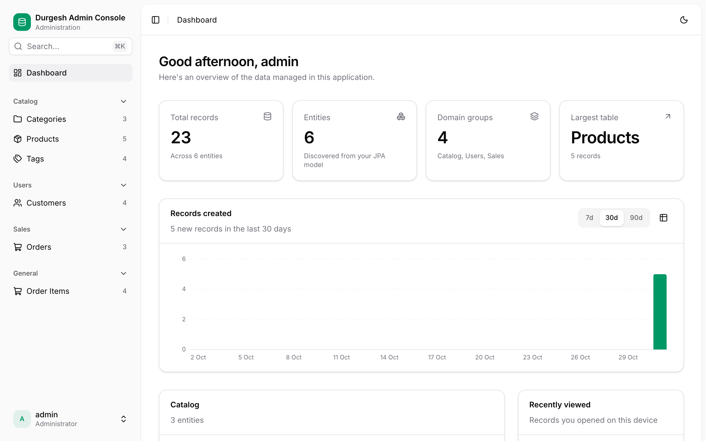{ .jpa-screenshot loading=lazy }
</figure>

- **Stat cards:** total records, number of entities, domain groups, and the largest table.
- **Records created:** a daily chart for the last 7, 30 or 90 days. Hover a column or use the arrow keys for the per-entity breakdown, or switch to the table view. It covers entities with a creation timestamp field (`createdAt`, `createdDate`, `createdOn`, `creationDate`, `creationTime`, `createTime` or `createdDateTime`); the card is hidden when there are none.
- **Groups:** every entity with its record count, permissions (Create · Edit · Delete) and custom actions, with a **+** button to create a record.
- **Recently viewed:** the last records you opened on this device.

## Browse records

Click an entity to open its table.

<figure markdown>
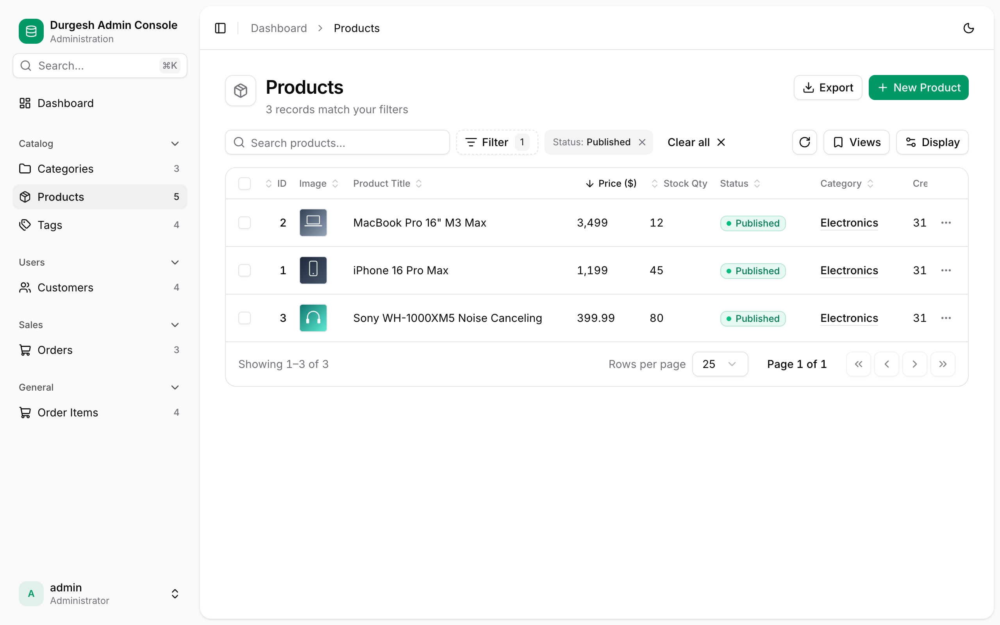{ .jpa-screenshot loading=lazy }
</figure>

### Search and sort

- **Search** matches text across the entity's searchable fields as you type. If no field is marked `searchable`, every text field is searched.
- **Sort** by clicking a column header; click again to reverse. The arrow shows the current direction.

### Readable values

Values are formatted for people, not databases:

| Data | Shown as |
| --- | --- |
| Dates and times | `31 Oct 2026, 13:54` in your locale; hover for the exact value and "3 hours ago" |
| Enums | Colored badges with readable labels (`OUT_OF_STOCK` → "Out of stock"). Colors follow meaning (red for cancelled or failed, green for active or paid, amber for pending) unless set with `@AdminBadge`. |
| Booleans | ✓ Yes / ✕ No |
| Numbers | Grouped digits, right-aligned |
| Relations | The related record's name, linked to its page |
| Many-to-many | Chips for the first few, then "+3" |
| UUIDs and IDs | Shortened (`e15cf53c`), with the full value on hover and a copy button |
| Emails | Clickable `mailto:` links |
| Images | Thumbnails |
| Files | A file chip with the name |
| Colors | A swatch with the hex value |
| Secrets | `••••••••` |
| Empty | A muted dash |

### Filter records

Click **Filter** to filter by any field marked `filterable`. The control depends on the field type:

| Field type | Filter |
| --- | --- |
| Text | "Contains" search, ignoring case |
| Enum / Boolean | Choose a value |
| Relation | Searchable picker, for example Category: Electronics |
| Number | Min and max |
| Date / date-time | From and to (a date covers the whole day) |

Active filters appear as chips you can remove one by one, or all at once with **Clear all**.

<figure markdown>
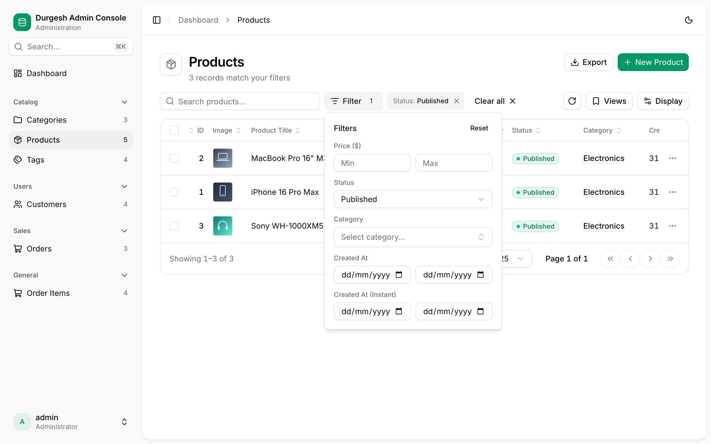{ .jpa-screenshot loading=lazy }
</figure>

### Saved views

Click **Views → Save current view…** to name the current search, filters and sort, for example "Out of stock". Choose a saved view to restore it. Views are stored per entity in this browser.

### Display options

**Display** sets the row density (comfortable or compact) and which columns are visible. Both are remembered in this browser.

### Edit in place

Hover a cell and click the pencil to change it without opening the form. This works for text, numbers, enums, booleans, dates and single relations. The change saves immediately and shows the same validation errors as the form.

<figure markdown>
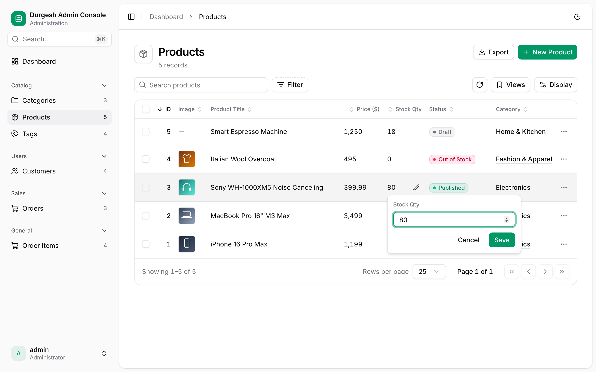{ .jpa-screenshot loading=lazy }
</figure>

### Row actions

Click a row to open it, or ++cmd++/++ctrl++-click to open it in a new tab. The **⋯** menu at the end of each row has:

- **View details**, **Edit**, **Duplicate** (opens a pre-filled create form), **Copy ID**
- Custom actions from `@AdminAction` (with a confirmation if one is configured)
- **Delete** (always asks for confirmation)

### Bulk actions

Tick rows, or the header checkbox to select the whole page. A bar appears with bulk custom actions and **Delete**.

<figure markdown>
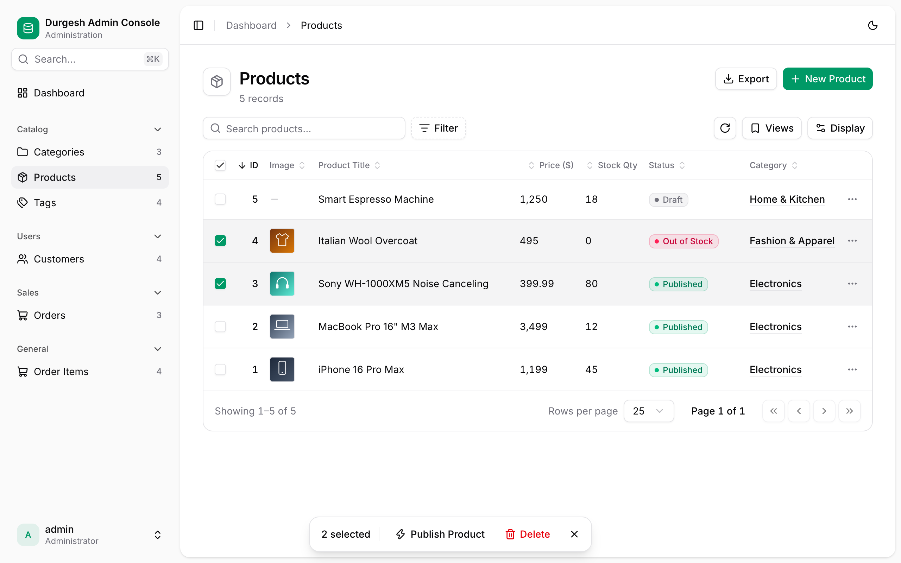{ .jpa-screenshot loading=lazy }
</figure>

### Export

**Export** downloads the current results (search and filters applied, visible columns, up to 50,000 rows) as a CSV file that opens cleanly in Excel. Cells that start with `=`, `+`, `-` or `@` are escaped so spreadsheets don't run them as formulas. It's hidden when `export-enabled` is `false` or the entity sets `exportable = false`.

### Pages

Choose 10, 25, 50 or 100 rows per page, and use the first, previous, next and last buttons. Empty states explain what's going on: "No products yet" with a create button, or "No matching records" with a way to clear filters.

## View a record

<figure markdown>
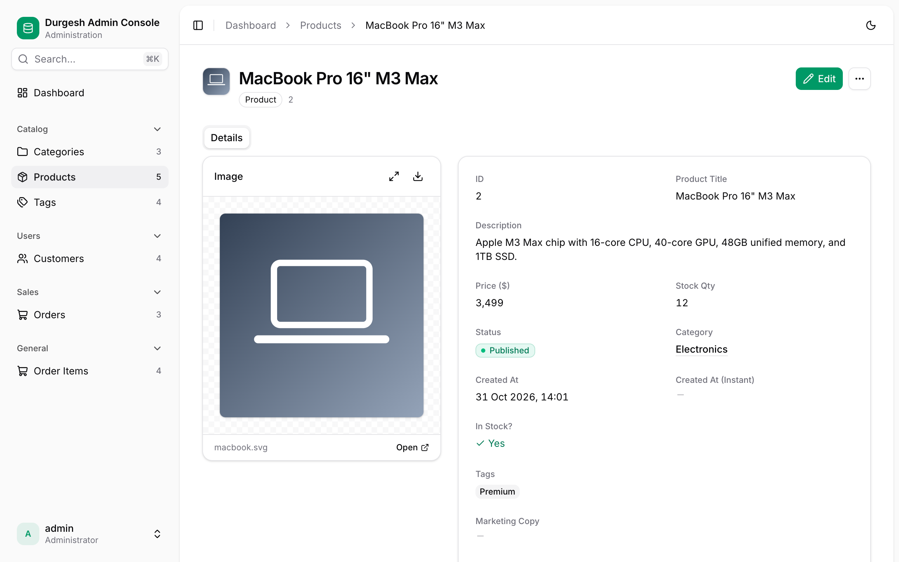{ .jpa-screenshot loading=lazy }
</figure>

- **Header:** the record's name, entity type, short ID with a copy button, **Edit**, and a **⋯** menu (Duplicate, Copy ID, custom actions, Delete). If the record has an image, it replaces the icon.
- **Details:** every field, fully formatted. Rich text is rendered and code is shown as a code block.
- **Images:** shown in a panel beside the details. Click to open a full-size viewer with download and "open original". Records without an image show an **Upload image** shortcut.
- **Related tabs:** one tab per `@AdminInline` collection (for example *Order Line Items*), with a count and links to each row.

## Create and edit records

<figure markdown>
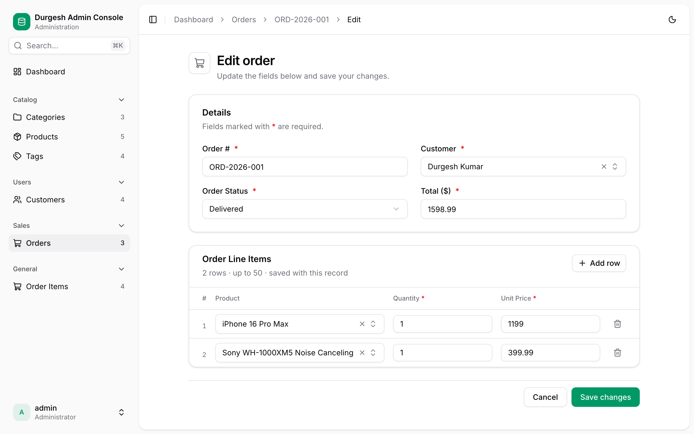{ .jpa-screenshot loading=lazy }
</figure>

### Fields

Each field gets a control that suits its type:

| Field | Control |
| --- | --- |
| Text | Text input (email and URL keyboards where relevant) |
| Long text (`TEXTAREA`) | Multi-line box |
| Rich text (`RICH_TEXT`) | Formatting toolbar: bold, italic, strikethrough, code, heading, lists, quote, undo and redo |
| Code (`CODE_EDITOR`) | Editor with line numbers and syntax-aware editing |
| Number | Numeric input |
| Boolean | Switch |
| Enum | Dropdown with readable labels |
| Date / date-time | Native date and date-time pickers |
| Single relation | Searchable picker with a clear button |
| Many-to-many | Multi-select with chips |
| Color (`COLOR_PICKER`) | Color picker plus hex input |
| Secret / password | Masked input with a reveal button. When editing, leave it blank to keep the current value. |
| Upload (`@AdminUpload`) | Drag-and-drop uploader (see below) |

Read-only, computed and generated fields are shown but not editable.

### Validation

Required fields are marked with **\***. Values are checked as you save: required fields, minimum and maximum, length, email format and patterns. Errors appear under each field, and the first one gets focus. The server checks again with Bean Validation, and its errors also appear next to the right field, including cells in inline rows. Problems the server finds that aren't tied to a field, such as a duplicate value in a unique column, appear at the top of the form.

### Inline rows

Collections marked with `@AdminInline` (for example an order's line items) are edited as rows inside the parent form: change rows, **Add row**, or remove one with the bin icon. Everything is saved together with the parent in one transaction.

### Uploads

Upload fields accept drag and drop or a click to browse. Before uploading, they check the file type and size. While uploading you see a preview, a progress bar with percentage, speed and time left, and a cancel button. **Save** waits ("Waiting for upload…") until uploads finish. Afterwards you can replace or remove the file.

<figure markdown>
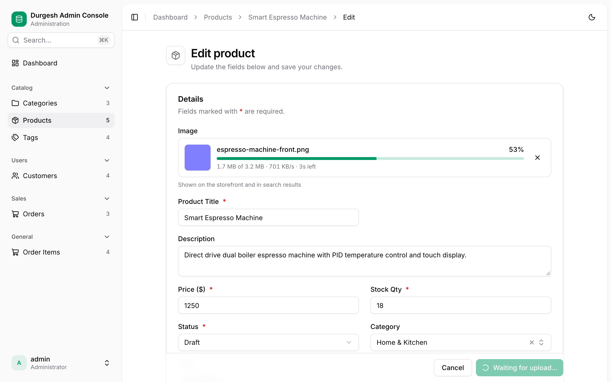{ .jpa-screenshot loading=lazy }
</figure>

### Rich text and code

<figure markdown>
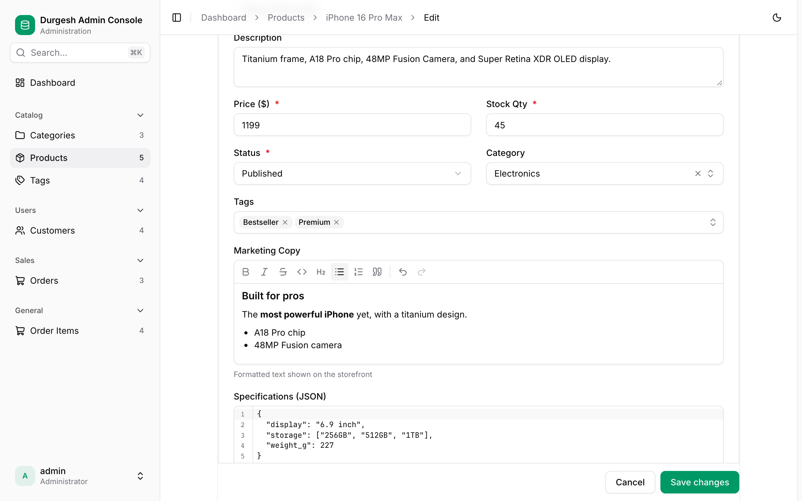{ .jpa-screenshot loading=lazy }
</figure>

### Saving and leaving

The save bar stays at the bottom while you scroll. An **Unsaved changes** marker appears when you've edited something. Leaving the page with unsaved changes (through a link or the Back button) asks you to **Keep editing** or **Discard changes**; closing the tab triggers the browser's own warning. After saving you land on the record's page with a confirmation toast.

**Duplicate** opens a create form pre-filled from an existing record (minus its ID and secrets), with " (copy)" added to its name.

## Keyboard shortcuts

Shortcuts are ignored while you type in a field. Press <kbd>?</kbd> anywhere to see this list.

| Where | Keys | Action |
| --- | --- | --- |
| Anywhere | ++cmd+k++ / ++ctrl+k++ | Open the command palette |
| Anywhere | <kbd>?</kbd> | Show keyboard shortcuts |
| Anywhere | ++cmd+b++ / ++ctrl+b++ | Collapse or expand the sidebar |
| Tables | ++slash++ | Focus search |
| Tables | ++n++ | New record |
| Tables | ++j++ / ++k++ | Next / previous row |
| Tables | ++enter++ | Open the focused row |
| Tables | ++e++ | Edit the focused row |
| Tables | ++x++ | Select the focused row |
| Record page | ++e++ | Edit this record |
| Menus and dialogs | ++esc++ | Close |

## Themes

Choose **Light**, **Dark** or **System** from the account menu or the command palette, or flip between light and dark with the sun/moon button in the header. The choice is remembered per browser and applied before the page renders, so there's no flash.

<figure markdown>
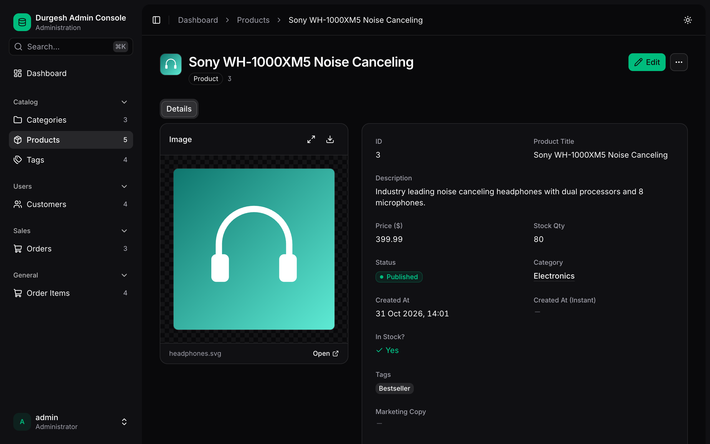{ .jpa-screenshot loading=lazy }
</figure>

## What's stored in your browser

Some preferences live only in your browser (`localStorage`) and don't sync between devices or users: the theme, collapsed sidebar groups, hidden columns, row density, saved views and recently viewed records.

## Manage admin users and groups

Database superusers see **Users and groups** with a people icon in the sidebar. The screen includes summary counts, searchable Users/Groups tabs, account status, access level, group badges, member counts and edit/delete actions.

- Use **Add group** to choose entity permissions from a matrix. Search narrows entities without clearing existing selections. Per-entity Select all includes that entity's custom actions. Write/action selection enables View; clearing View clears the entity's grants in that group.
- Use **Add user** to create a dedicated admin account and assign groups. Active and Allow admin access control entry. Superuser enables security management and bypasses group assignment, while retaining entity hard restrictions.
- Edit a user to change groups, disable access or set a new password. Leave the password blank to keep it. Effective assigned permissions shows the combined group grants; it is not a per-user override editor.
- Delete a group to revoke its grants from members. The users themselves remain. Deleting an account removes only the dedicated admin identity.
- Save/Cancel remain visible while dialog contents scroll. On a narrow screen, scroll the permission table horizontally to reach all columns. Close/Cancel discards the current editor without saving; there is no unsaved-change prompt for this screen.

If the screen is missing, check database mode and your superuser status. An empty group list is normal on a fresh installation. The library does not create job-specific groups automatically. See [the practical setup guide](practical-guide.md) for a reader/editor example.
