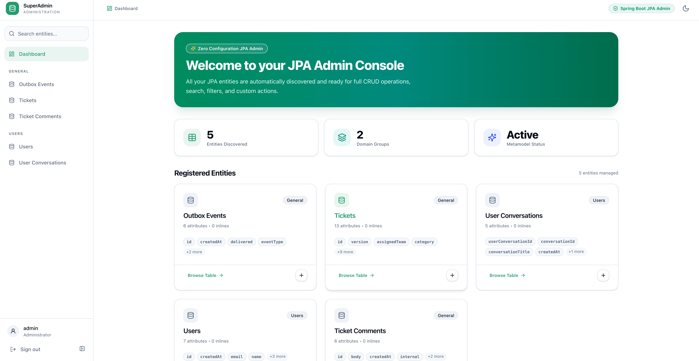
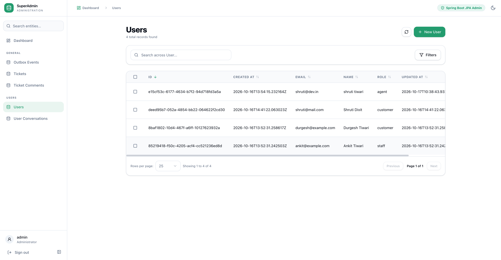
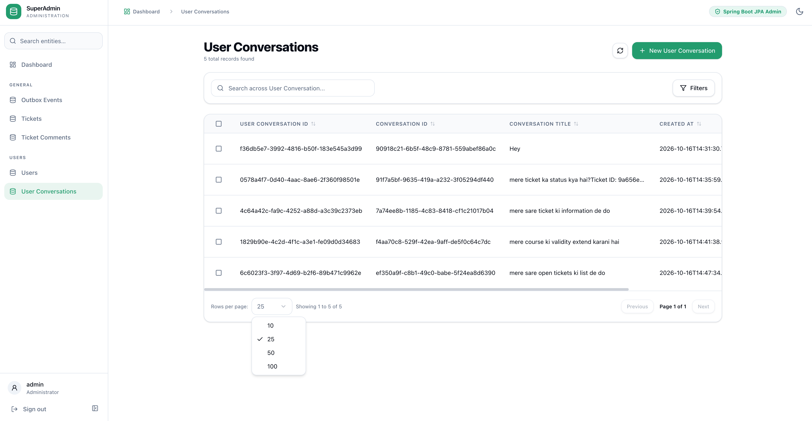
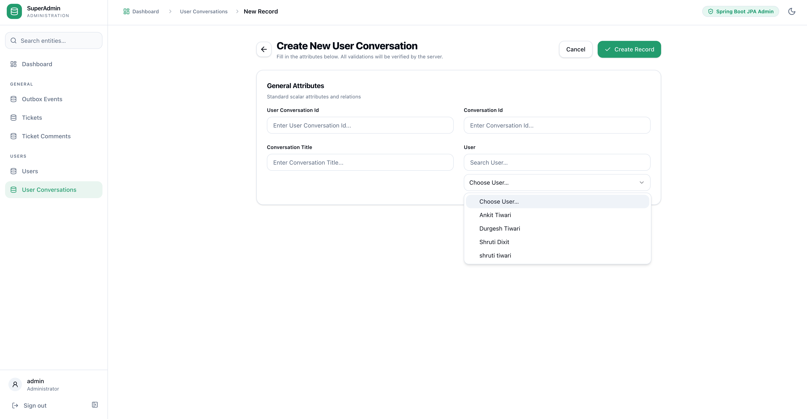
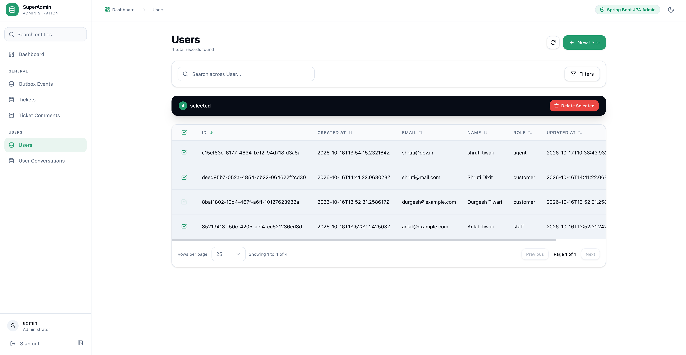
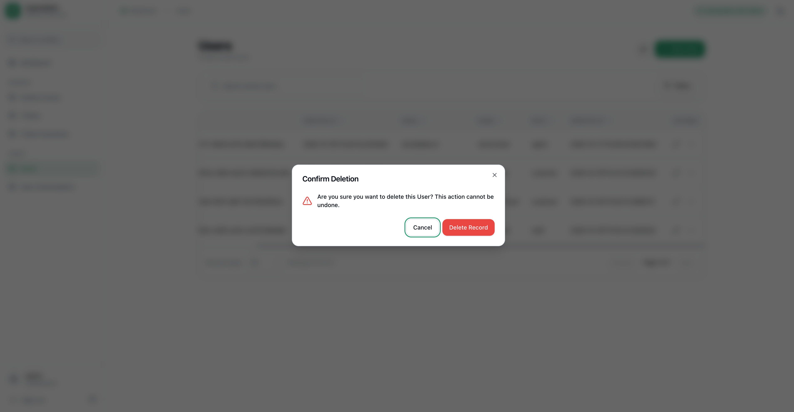
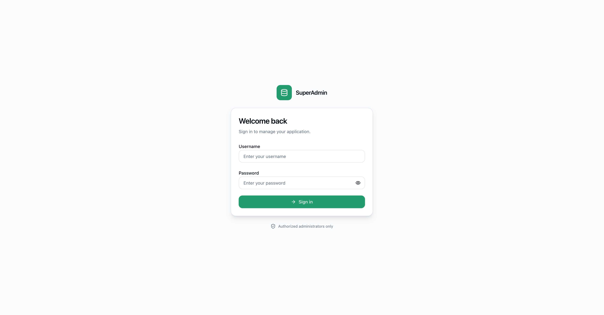

# User Guide

This guide walks through using the administration console to manage entities, search records, handle foreign key relationships, and execute bulk operations.

---

## 1. Dashboard & Entity Discovery

Upon signing in, the dashboard automatically indexes and presents all detected JPA entities categorized by domain group.

- **KPI Cards:** Shows discovered entity count, domain groups, and metamodel status.
- **Entity Cards:** Display attribute counts, quick "Browse Table" links, and direct record creation shortcuts (`+`).
- **Sidebar Navigation:** Collapsible left navigation bar listing all domain groups and individual entity models with instant search filtering.

---

## 2. Exploring & Filtering Records

Clicking any entity opens its dedicated data table with built-in search, sorting, and pagination.

### Features:
- **Instant Search:** Type in the search bar to query across all searchable entity attributes in real time.
- **Column Sorting:** Click column headers (e.g., `CREATED AT`, `EMAIL`, `ROLE`) to toggle ascending or descending sorts.
- **Pagination & Page Size:** Navigate through pages or change page size using the dropdown selector.

---

## 3. Creating & Editing Records (Foreign Key Relations)

Entity forms are dynamically generated from JPA metamodel specifications and field annotations.

### Foreign Key Dropdowns:
- **Automatic Metamodel Resolution:** `@ManyToOne` and `@OneToOne` relationships render as searchable selectboxes.
- **Descriptive Labels:** Rather than showing unreadable database IDs, related options display readable strings via the target entity's `toString()` or marked `@AdminField` identifier (e.g., `"Durgesh Tiwari"`, `"Shruti Dixit"`).
- **Date & Time Attributes:** Timestamps (e.g., `createdAt`, `updatedAt`) are properly parsed without type mismatches.
- **Sensitive Fields:** Passwords or secrets left blank during updates preserve their existing database values.

---

## 4. Batch Operations & Safe Deletions

Select one or multiple rows to perform bulk actions directly from the table interface.

- **Multi-Record Selection:** Check individual rows or the select-all checkbox to highlight items across the table.
- **Bulk Action Bar:** Appears automatically at the top of the table showing selection counts and available actions like **Delete Selected**.
- **Confirmation Safety Modals:** Destructive actions prompt an explicit confirmation modal before executing API deletions to prevent accidental data loss.

---

## 5. Security & Authentication

Access to `/admin/` is protected by cookie-backed session authentication and automated CSRF token handling.

- **Dedicated Login Portal:** Beautiful, isolated login interface matching the application theme.
- **CSRF Token Rotation:** Every state-modifying action (create, update, delete) requires valid CSRF tokens automatically handled by the frontend client.
- **Theme Switcher:** Toggle between light and dark modes via the header control.
